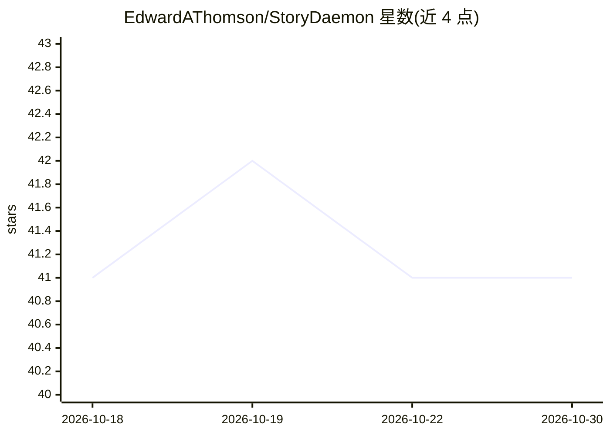

# EdwardAThomson/StoryDaemon

⭐ 41 · Python · 推送 2026-10-18 · [GitHub](https://github.com/EdwardAThomson/StoryDaemon) · 个人维护

**自主 agent 生成长篇小说：规划、写作并演化叙事**

Python 编写的长篇小说生成系统：LLM 驱动的 agent 通过迭代“story tick”循环产出场景段落，每轮包含情节拍检查、状态摘要、规划、工具执行、深视角写作、连续性与张力评估、记忆更新等步骤。支持角色/地点/世界观演化的记忆系统与向量索引，可选 plot-first 模式与场景骨架。后端可选 Codex CLI（默认）、Gemini CLI、Claude Code CLI 或多家 API（OpenAI/Anthropic/Gemini/OpenRouter/自托管等），并支持从 worldgen 世界 JSON 导入设定与构造语言。以 CLI（novel 命令）操作，git clone 源码安装，需 Python 3.11+。

## 筛选速览

| 维度 | 判定 | 备注 |
|---|---|---|
| AI 角色 | `ai-native` | 本体是模型或模型工具 |
| 许可风险 | `none` | — |
| 部署形态 | `library` | 以包/库形式分发 |
| 模型依赖 | locked-api |  |
| 硬件要求 | — | 无带数字的原话,不猜 |
| 安装摩擦 | `low` | 无编译、无系统依赖或容器化 |
| 成熟度 | — | 结构信号不足 |

## 能力要点

- story tick 循环：规划-写作-评估-记忆更新的自主叙事生成
- 演化式记忆系统：角色、地点、lore、目标层级、开放线索与向量语义检索
- LLM 张力评分（0-10）与连贯性压力（弧线张力、贯穿线门控、矛盾检测）
- 支持从 worldgen 世界 JSON 导入设定与构造语言（无需 LLM 参与）

## 适用场景

- 长篇小说创作者用 agent 自动生成多场景叙事草稿
- 以可选的题材/前提/基调约束引导涌现式故事发展
- 导入已生成的奇幻区域或科幻星区世界设定开局

## 场景标签

`AI 写作` · 领域:内容生成

## 证据(README 行号)

> L7: StoryDaemon is a Python-based system that generates long-form fiction through an autonomous agent that plans, writes
> L82: 3. **Plan** - Planner LLM decides which tools to use, scene intention, and optional length guidance
> L84: 5. **Write** - Writer LLM generates prose in deep POV (flexible length based on scene needs)

## 星数曲线

2026-10-18 41 → 2026-10-30 41（+0）

---
*卡片 v1 · prompt 1.4 · 生成 2026-10-25 · 置信度 mid · 依据 README sha `4f0640d2c6a8` · [字段定义](../../DATASET.md)*
