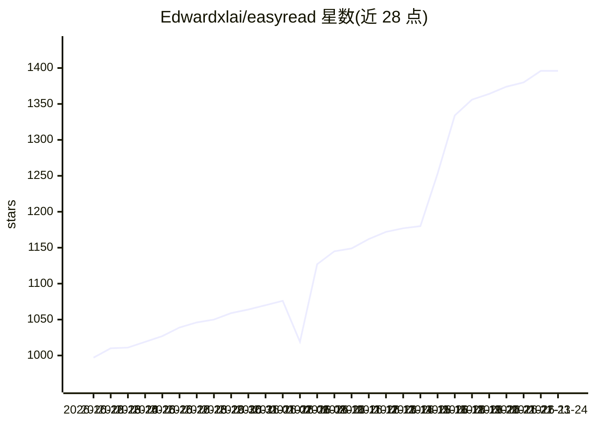

# Edwardxlai/easyread

⭐ 1,396 · Python · MIT · 推送 2026-11-20 · [GitHub](https://github.com/Edwardxlai/easyread) · [官网](https://edwardxlai.github.io/easyread/) · 个人维护 · 中文 README

**给科研读者：本地 PDF 论文翻译与原文对照阅读器**

面向读英文论文的中文读者，提供 PDF 导入、段落级翻译与原文/PDF 对照阅读；可划线记笔记、在段落旁向 AI 提问，并支持 arXiv 编号导入与博客链接导入。文献库存储在本机；翻译与提问通过已登录的受支持 CLI 或配置的模型 API 完成，相关内容会交给所选模型处理。提供 Windows/macOS/Linux 桌面安装包，也可用 Python 3.10+ 从源码运行，采用 MIT 许可。

## 筛选速览

| 维度 | 判定 | 备注 |
|---|---|---|
| AI 角色 | `ai-enhanced` | 去掉 AI 部分产品仍成立 |
| 许可风险 | `permissive` | MIT |
| 部署形态 | `desktop` | 安装包/桌面程序 |
| 模型依赖 | — | README 未给出锁定关系 |
| 硬件要求 | — | 无带数字的原话,不猜 |
| 安装摩擦 | `low` | 无编译、无系统依赖或容器化 |
| 成熟度 | — | 结构信号不足 |

## 能力要点

- PDF 段落翻译与原文/PDF 对照阅读
- 划线记笔记、段落旁问 AI，全库问答并经引文回到原段落
- 支持 arXiv 编号与博客链接导入
- 提供 Windows/macOS/Linux 桌面安装包，亦可源码运行

## 适用场景

- 本地导入英文 PDF，边对照原文边读中文译文
- 读论文时对难句向 AI 提问并记录笔记
- 管理个人文献库并用「全库问 AI」检索以前读过的内容

## 场景标签

`科研工具` `知识库管理` `文档问答` · 领域:知识与检索

## 证据(README 行号)

> L3: 让你更舒服地读论文。导入 PDF，第一段译好就能开始读。遇到难句，展开原文或对照 PDF，在段落旁划线、记笔记、问 AI。也可以直接读英文原文。
> L18: 2. 要翻译或提问时，在设置中选择已登录的受支持 CLI，或配置模型 API。文献库存放在本机，翻译和提问会把相关内容交给所选模型处理。

## 星数曲线

2026-10-22 997 → 2026-11-24 1,396（+399）

---
*卡片 v1 · prompt 1.4 · 生成 2026-11-23 · 置信度 high · 依据 README sha `bb405fb23a9f` · [字段定义](../../DATASET.md)*
