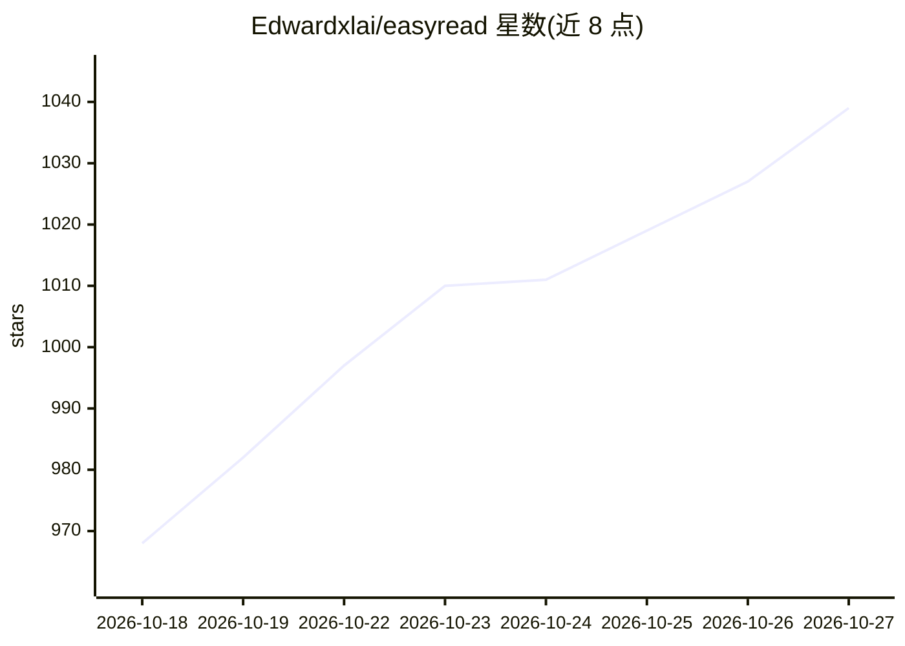

# Edwardxlai/easyread

⭐ 1,039 · Python · MIT · 推送 2026-10-25 · [GitHub](https://github.com/Edwardxlai/easyread) · [官网](https://edwardxlai.github.io/easyread/) · 个人维护 · 中文 README

**本地 PDF 论文翻译阅读器：中文对照、划线笔记、边读边问 AI**

运行在本地的论文阅读与翻译工具：导入 PDF（支持 arXiv 编号、DOI、OpenReview 等自动获取），后台逐页翻译成中文，译文与原页对照、KaTeX 重排公式；支持划线、笔记、页边 AI 问答、术语表全文替换。翻译模型由用户选择：Claude Code、Codex、DeepSeek、智谱、本机 Ollama 等多种引擎。附文献库管理、Zotero 迁移、离线 HTML 导出与命令行接口（可供 Claude Code/Codex agent 调用）。提供 Windows/macOS/Linux 安装包与 pip 安装，数据本地存储。

## 筛选速览

| 维度 | 判定 | 备注 |
|---|---|---|
| AI 角色 | `ai-native` | 本体是模型或模型工具 |
| 许可风险 | `permissive` | MIT |
| 部署形态 | `desktop` | 安装包/桌面程序 |
| 模型依赖 | local-ok | 支持本地模型 |
| 硬件要求 | — | 无带数字的原话,不猜 |
| 安装摩擦 | `low` | 无编译、无系统依赖或容器化 |
| 成熟度 | — | 结构信号不足 |

## 能力要点

- 逐页后台翻译，译文与原页对照，KaTeX 重排公式
- 多引擎可选：Claude Code、Codex、DeepSeek、智谱、本机 Ollama 等
- 划线、笔记、页边 AI 问答与术语表全文替换
- Zotero/文件夹迁移、离线 HTML 导出、easyread 命令行供 agent 调用

## 适用场景

- 把英文论文译成中文对照阅读并做批注笔记
- 阅读时向 AI 提问、引用多段讨论
- 从 Zotero 迁移文献库并分类管理、导出引用

## 场景标签

`科研工具` `文档问答` · 领域:知识与检索

## 证据(README 行号)

> L5: 导入 PDF，后台逐页翻译；公式、表格照原文排好，随时对照原文，边读边划线、记笔记、提问。
> L25: - **边读边问 AI。** 右侧“问 AI”面板实时对话，回答逐字流出来；可以一次引用好几段（选中文字拖进输入框就行）。问“我标红的那些公式有什么联系”，它会按颜色找出你的划线。可以开多个对话，模型单独选：Claude、GPT（
> L47: |**Claude Code**（推荐）|装好并登录 Claude Code|不用 Key，用你订阅的额度；会自己看原页图核对公式，译文最好|

## 星数曲线

2026-10-18 968 → 2026-10-27 1,039（+71）

---
*卡片 v1 · prompt 1.4 · 生成 2026-10-21 · 置信度 mid · 依据 README sha `c54c82e44673` · [字段定义](../../DATASET.md)*
