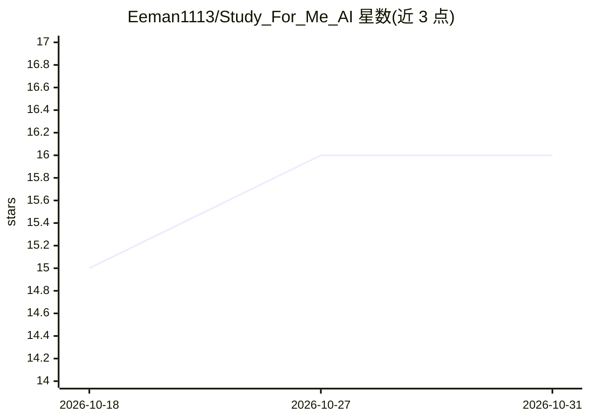

# Eeman1113/Study_For_Me_AI

⭐ 16 · Jupyter Notebook · MIT · 推送 2026-04-24 · [GitHub](https://github.com/Eeman1113/Study_For_Me_AI) · 个人维护

**基于 RoBERTa 的文本问答应用：从用户文本中找答案**

一个 Streamlit 网页应用，用户粘贴大段文本后，以 RoBERTa 模型在其上抽取式问答，返回所提问题的答案。仓库主题标签含 python、transformers、roberta、streamlit。README 仅说明动机（懒得通读长文本、让 AI 代读并回答问题），未给出安装命令、硬件要求或使用步骤，文档信息有限。

## 筛选速览

| 维度 | 判定 | 备注 |
|---|---|---|
| AI 角色 | `ai-native` | 本体是模型或模型工具 |
| 许可风险 | `permissive` | MIT |
| 部署形态 | `None` |  |
| 模型依赖 | — | README 未给出锁定关系 |
| 硬件要求 | — | 无带数字的原话,不猜 |
| 安装摩擦 | `low` | 无编译、无系统依赖或容器化 |
| 成熟度 | — | 结构信号不足 |

## 能力要点

- 基于 RoBERTa 的抽取式问答
- 用户自行提供文本作为问答范围
- 以 Streamlit 提供网页界面（据主题标签）

## 适用场景

- 在长文档中快速定位某问题的答案
- 不想通读全文时让模型代读并回答提问

## 场景标签

`文档问答` · 领域:知识与检索

## 证据(README 行号)

> L2: So, there are loads of time when I have a big amount of text and I now it has the data that I need but way too lazy 

## 星数曲线

2026-10-18 15 → 2026-10-31 16（+1）

---
*卡片 v1 · prompt 1.4 · 生成 2026-10-30 · 置信度 mid · 依据 README sha `b5d969e9c430` · [字段定义](../../DATASET.md)*
