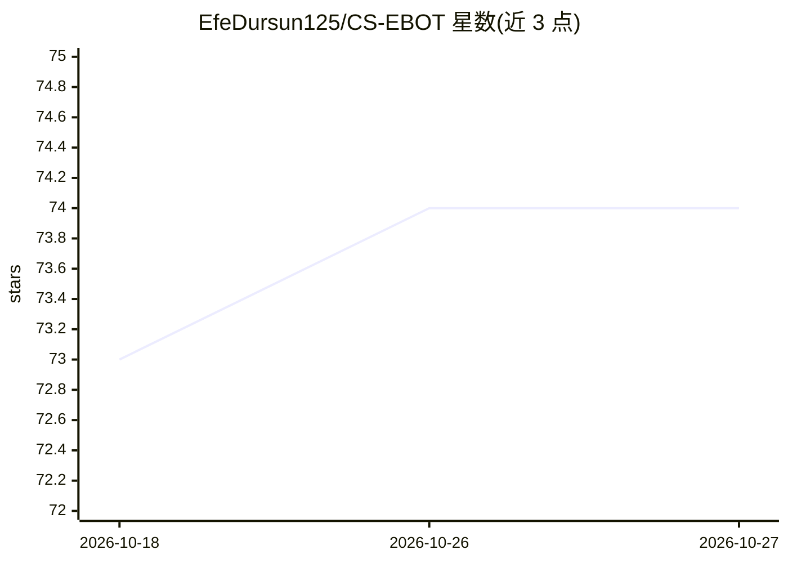

# EfeDursun125/CS-EBOT

⭐ 74 · C++ · MPL-2.0 · 推送 2026-06-02 · [GitHub](https://github.com/EfeDursun125/CS-EBOT) · [官网](https://ebots-for-cs.blogspot.com/) · 个人维护

**CS 1.6 僵尸模式专用 AI 机器人插件**

基于 SyPB（YaPB 分支系）的 Counter-Strike 1.6 服务端 AI 机器人，以 Metamod 插件形式运行，仅支持 zombie plague/escape 与 biohazard 游戏模式。安装方式为下载发行包放入 cstrike\addons 目录，并在 metamod 的 plugins.ini 中注册 Windows 的 ebot.dll 或 Linux 的 ebot.so。Windows 环境需要安装 VCRedist 运行库，否则控制台 meta list 时出现 badf load。项目通过博客下载与 Discord/Steam 社区维护。

## 筛选速览

| 维度 | 判定 | 备注 |
|---|---|---|
| AI 角色 | `ai-enhanced` | 去掉 AI 部分产品仍成立 |
| 许可风险 | `permissive` | MPL-2.0 |
| 部署形态 | `None` |  |
| 模型依赖 | — | README 未给出锁定关系 |
| 硬件要求 | — | 无带数字的原话,不猜 |
| 安装摩擦 | `low` | 无编译、无系统依赖或容器化 |
| 成熟度 | — | 结构信号不足 |

## 能力要点

- 基于 SyPB 的 CS 1.6 服务端 AI 机器人
- 仅面向 zombie plague/escape 与 biohazard 模式
- 以 Metamod 插件形式运行，支持 Windows 与 Linux

## 适用场景

- 僵尸灾变/生化模式服务器添加 AI 机器人
- 为 CS 1.6 联机服务器补充对战人数

## 场景标签

 · 领域:游戏/服务器插件

## 证据(README 行号)

> L2: AI Bot for Counter-Strike based on SyPB, this bot is only for zombie plague/escape and biohazard gamemodes.
> L15: # How to install

## 星数曲线

2026-10-18 73 → 2026-10-27 74（+1）

---
*卡片 v1 · prompt 1.4 · 生成 2026-10-24 · 置信度 high · 依据 README sha `bf8af454db19` · [字段定义](../../DATASET.md)*
