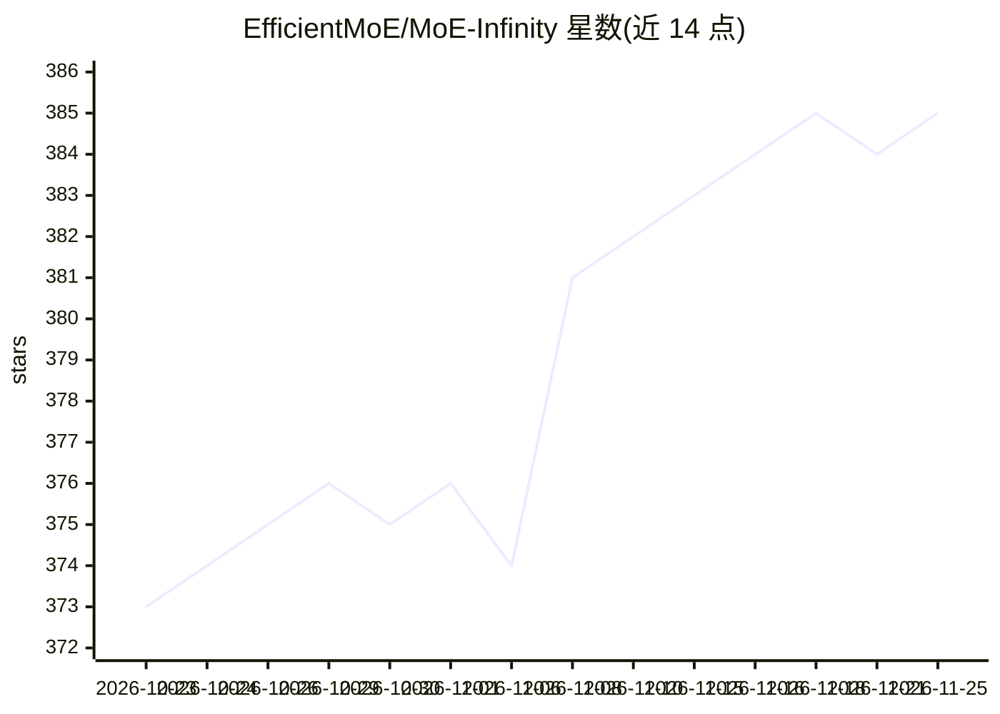

# EfficientMoE/MoE-Infinity

⭐ 385 · Python · Apache-2.0 · 推送 2026-11-20 · [GitHub](https://github.com/EfficientMoE/MoE-Infinity) · 组织维护

**为 MoE 大模型提供低显存推理与 OpenAI 兼容服务的 PyTorch 库**

面向在显存受限 GPU 上运行混合专家（MoE）模型的场景：将专家权重卸载到主存与 SSD，配合激活感知缓存、追踪与预取减少传输开销；提供 HuggingFace 兼容的 MoE 类和 OpenAI 兼容的 HTTP 服务引擎（continuous batching、paged KV cache、SSE 流式）。支持单机多 GPU，按 round-robin 分布专家；不支持跨机多节点。安装以 GitHub Release wheel（CUDA 12.8）为主，源码构建覆盖其他 CUDA/PyTorch 组合。

## 筛选速览

| 维度 | 判定 | 备注 |
|---|---|---|
| AI 角色 | `ai-ecosystem` | LLM/agent 周边工具 |
| 许可风险 | `permissive` | Apache-2.0 |
| 部署形态 | `library` | 以包/库形式分发 |
| 模型依赖 | — | README 未给出锁定关系 |
| 硬件要求 | — | 无带数字的原话,不猜 |
| 安装摩擦 | `high` | 编译与系统依赖俱全 |
| 成熟度 | — | 结构信号不足 |

## 能力要点

- 专家权重卸载到主存/SSD，激活感知缓存与预取
- OpenAI 兼容 HTTP 服务：continuous batching、paged KV cache、SSE 流式
- 支持 DeepSeek/Mixtral/Qwen3-MoE/GLM 等系列 HuggingFace MoE checkpoint
- 可选 FlashAttention/FlashInfer 集成，缺失时回退内置 kernel

## 适用场景

- 在显存不够装下整个 MoE 模型的 GPU 上做推理
- 部署 OpenAI 兼容的 MoE 模型服务接口
- 单机多卡环境下分配专家参数进行推理

## 场景标签

`推理引擎` · 领域:训练与推理

## 证据(README 行号)

> L3: MoE-Infinity is a cost-effective, fast, and easy-to-use library for Mixture-of-Experts (MoE) inference.
> L7: MoE-Infinity runs large Mixture-of-Experts models on memory-constrained GPUs by offloading expert weights to host me

## 星数曲线

2026-10-23 373 → 2026-11-25 385（+12）

---
*卡片 v1 · prompt 1.4 · 生成 2026-11-25 · 置信度 mid · 依据 README sha `7cfc2032cd7e` · [字段定义](../../DATASET.md)*
