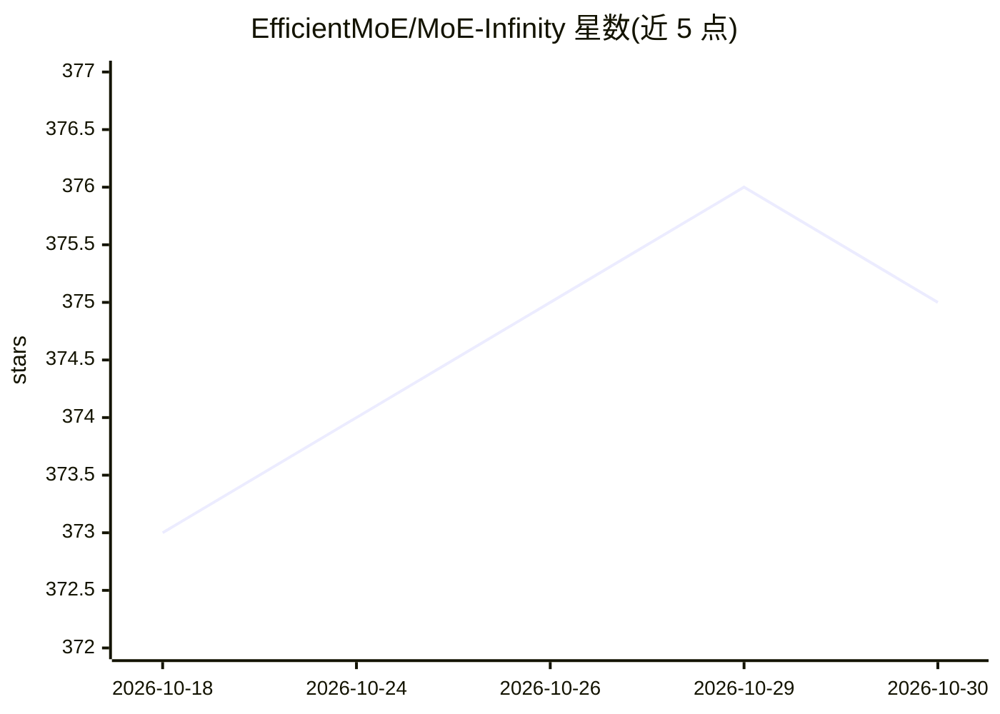

# EfficientMoE/MoE-Infinity

⭐ 375 · Python · Apache-2.0 · 推送 2026-10-29 · [GitHub](https://github.com/EfficientMoE/MoE-Infinity) · 组织维护

**在显存受限 GPU 上服务 MoE 大模型的 PyTorch 推理库**

面向 MoE（混合专家）大模型推理的 PyTorch 库：将专家权重卸载到主机内存与 SSD，按需取回，配合激活感知缓存、tracing 与预取隐藏传输开销，使超出显存的 MoE 模型可在小显存 GPU 上运行。提供 HuggingFace 兼容的 MoE 类与 OpenAI 兼容服务引擎（连续批处理、分页 KV 缓存、SSE 流式），支持单机多卡（专家参数轮询分布），不支持多机分布式。安装以 GitHub Release 轮子或源码编译为主，PyPI 上的占位包不可用。

## 筛选速览

| 维度 | 判定 | 备注 |
|---|---|---|
| AI 角色 | `ai-ecosystem` | LLM/agent 周边工具 |
| 许可风险 | `permissive` | Apache-2.0 |
| 部署形态 | `library` | 以包/库形式分发 |
| 模型依赖 | locked-api |  |
| 硬件要求 | `gpu-8g` | |
| 安装摩擦 | `high` | 编译与系统依赖俱全 |
| 成熟度 | — | 结构信号不足 |

## 能力要点

- 专家权重卸载至主机内存/SSD，激活感知缓存保留热专家在 GPU
- OpenAI 兼容服务引擎：连续批处理、分页 KV 缓存、SSE 流式、前缀缓存可选
- 单机多 GPU：专家参数轮询分布、按 GPU 缓存
- 支持 DeepSeek、Mixtral、Qwen3-MoE、GLM、GPT-OSS、DBRX 等模型

## 适用场景

- 在 16GB 级显存单卡上运行原本放不下的 MoE 模型
- 以 OpenAI 兼容 API 形式部署 MoE 模型服务
- 用 HuggingFace 兼容 API 在进程内运行 MoE 推理

## 场景标签

`推理引擎` · 领域:训练与推理

## 证据(README 行号)

> L3: MoE-Infinity is a cost-effective, fast, and easy-to-use library for Mixture-of-Experts (MoE) inference.
> L7: MoE-Infinity runs large Mixture-of-Experts models on memory-constrained GPUs by offloading expert weights to host me

## 星数曲线

2026-10-18 373 → 2026-10-30 375（+2）

---
*卡片 v1 · prompt 1.4 · 生成 2026-10-21 · 置信度 mid · 依据 README sha `d7ced6a8f077` · [字段定义](../../DATASET.md)*
