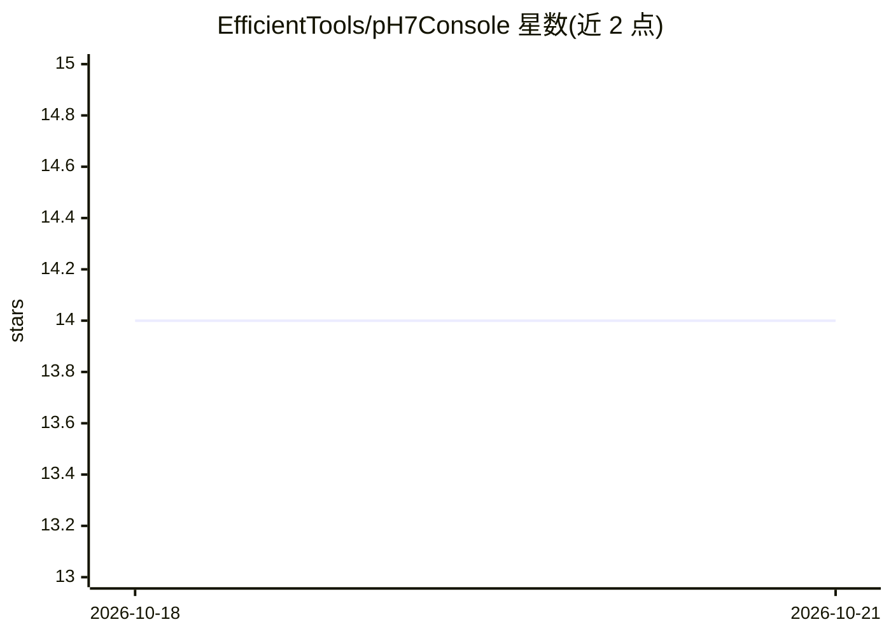

# EfficientTools/pH7Console

⭐ 14 · Rust · NOASSERTION · 推送 2026-08-13 · [GitHub](https://github.com/EfficientTools/pH7Console) · [官网](https://PierreHenry.dev) · 个人维护

**隐私优先的 macOS AI 终端：本地模型将自然语言转为 shell 命令**

基于 Tauri 2.0（Rust 后端 + React 前端）的 macOS 命令控制台。内置 Qwen2.5-Coder 紧凑模型，通过仅回环的 llama.cpp 助手在本地运行，将自然语言请求翻译为常见 shell 操作，并提供上下文补全、错误协助与基于加密本地历史的自适应工作流学习；确定性模式引擎在模型预热、取消或推理不可用时接管。无遥测、无云回退，历史以 SQLCipher 加密、密钥存于 macOS 钥匙串。通过 git clone 与 setup.sh 从源码构建，支持 Mac App Store 沙盒发行。

## 筛选速览

| 维度 | 判定 | 备注 |
|---|---|---|
| AI 角色 | `ai-enhanced` | 去掉 AI 部分产品仍成立 |
| 许可风险 | `none` | NOASSERTION |
| 部署形态 | `None` |  |
| 模型依赖 | — | README 未给出锁定关系 |
| 硬件要求 | — | 无带数字的原话,不猜 |
| 安装摩擦 | `low` | 无编译、无系统依赖或容器化 |
| 成熟度 | — | 结构信号不足 |

## 动量与使用信号

- 安装:github 包 `release-assets` 月下载无数据

## 能力要点

- 自然语言翻译为常见 shell 操作（含管道、重定向、引号路径执行）
- 内置 Qwen2.5-Coder 本地推理，无遥测、无云回退
- SQLCipher 加密历史 + Keychain 密钥的隐私工作流自适应
- 多会话工作区、独立持久 shell 标签页与快速恢复

## 适用场景

- 用自然语言描述任务来生成并执行 shell 命令
- 在不上云的前提下使用带本地模型的智能终端
- 输入时获得上下文相关补全与错误下一步建议

## 场景标签

`代码生成` `AI 助手` · 领域:编码与开发

## 证据(README 行号)

> L5: A privacy-first macOS command console built with Tauri. Its bundled local model, natural-language command matching, 
> L71: The current release bundles a compact Qwen2.5-Coder model and runs it through a verified loopback-only llama.cpp he

## 星数曲线

2026-10-18 14 → 2026-10-21 14（+0）

---
*卡片 v1 · prompt 1.4 · 生成 2026-10-18 · 置信度 high · 依据 README sha `a913390927fb` · [字段定义](../../DATASET.md)*
