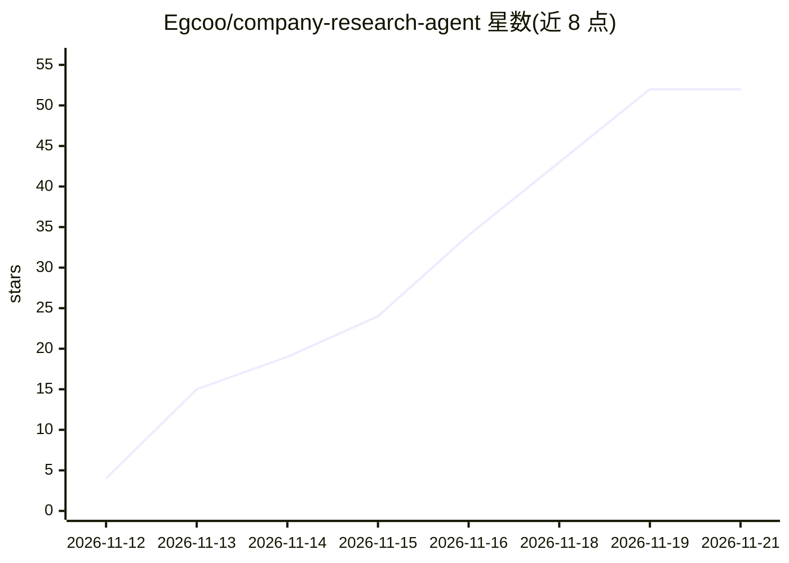

# Egcoo/company-research-agent

⭐ 52 · Python · MIT · 推送 2026-10-21 · [GitHub](https://github.com/Egcoo/company-research-agent) · 个人维护 · 中文 README

**输入代码与研究问题，自动生成中文投资研究报告的 Agent 系统**

以 Investment Master 为研究规范的投资研究工具：用户通过 CLI 输入股票 ticker 或基金代码、份额与研究问题，系统由一个 Research Agent 查找并阅读公开资料，程序负责取材、基金指标计算（收益、回撤、波动率等）、保存来源与笔记，最终流式生成九章中文 Markdown 研究报告，并可用独立评审命令对已生成报告做一次模型判卷。当前 MVP 仅支持美股完整研究与五类中国场外基金（被动指数/ETF联接/增强指数/混合/债券），需 Python 3.11+ 与 uv，配置 Anthropic 兼容模型、Tavily 搜索等 API Key；运行受 300 秒、模型/HTTP/工具调用次数上限约束，报告质量仍需人工复核。

## 筛选速览

| 维度 | 判定 | 备注 |
|---|---|---|
| AI 角色 | `ai-native` | 本体是模型或模型工具 |
| 许可风险 | `permissive` | MIT |
| 部署形态 | `None` |  |
| 模型依赖 | — | README 未给出锁定关系 |
| 硬件要求 | — | 无带数字的原话,不猜 |
| 安装摩擦 | `low` | 无编译、无系统依赖或容器化 |
| 成熟度 | `idea` | |

## 能力要点

- 同一 Research Agent 完成规划、分析并流式合成九章报告
- 基金净值、收益、最大回撤、波动率等指标由程序计算并可复算
- 来源窗口与笔记持续保存，报告中汇总实际读取的来源
- 独立评审命令（deepequity-review）可对已有报告做一次模型判卷

## 适用场景

- 生成美股公司的基本面与估值研究报告
- 研究中国场外基金并核对其净值、费用与披露数据
- 对已生成的报告另行启动模型审阅获取问题清单

## 场景标签

`金融量化` `科研工具` · 领域:学习与行业

## 证据(README 行号)

> L3: DeepEquity 是一个以 **Investment Master 为研究规范**的投资研究工具。输入标的代码和研究问题，它会查找、阅读公开资料，保存来源与研究笔记，生成中文 Markdown 投资研究报告。
> L18: 商业模式、行业、竞争与管理、财务预测、估值、风险和执行条件，由同一个 Research Agent 按 Skill 开展。规划在这个 Agent 内完成；报告合成是后续的模型调用。

## 星数曲线

2026-11-12 4 → 2026-11-21 52（+48）

---
*卡片 v1 · prompt 1.4 · 生成 2026-11-18 · 置信度 high · 依据 README sha `0089c2291e48` · [字段定义](../../DATASET.md)*
