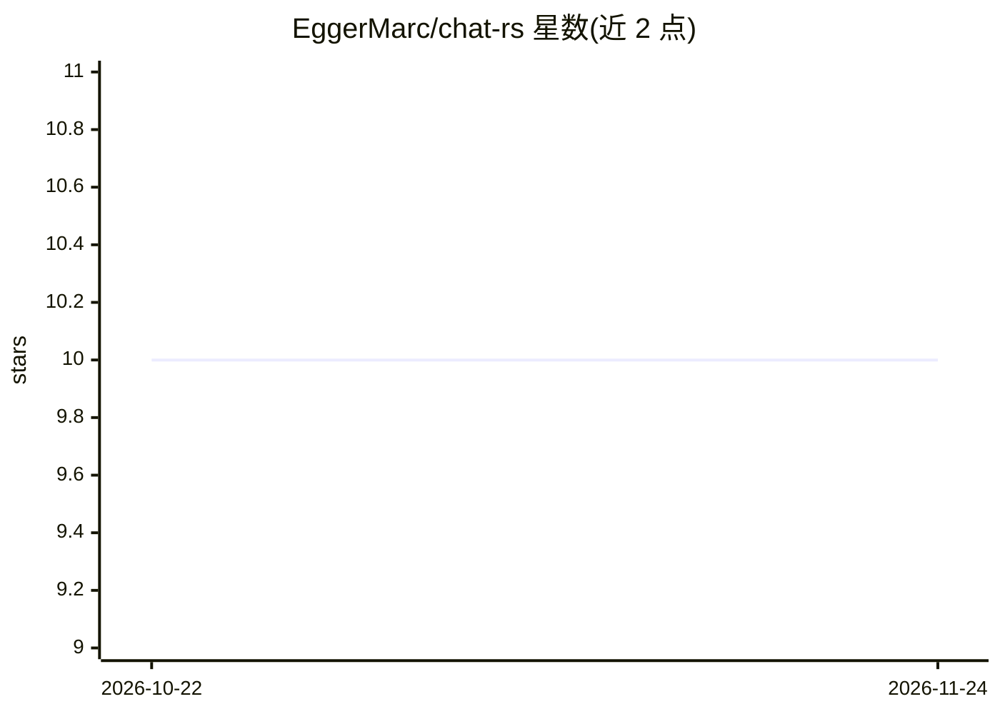

# EggerMarc/chat-rs

⭐ 10 · Rust · 推送 2026-08-20 · [GitHub](https://github.com/EggerMarc/chat-rs) · [官网](https://chat-rs.com) · 个人维护

**Rust 开发者的多供应商 LLM 框架：一行代码切换提供商**

面向 Rust 开发者的多供应商 LLM 接入框架，通过类型状态 builder 在编译期保证配置合法，覆盖工具调用、结构化输出、流式响应、嵌入向量等能力，并提供跨多提供商的路由（含降级回退、熔断器与关键字/嵌入/能力策略）。支持在 `#[tool]` 宏定义的 Rust 工具之外，经 PyO3 在运行时加载 Python 脚本工具；敏感工具调用可暂停等待人工审批后续跑。传输层可插拔（HTTP/WS/自定义），MSRV 为 Rust 1.94，MIT 许可。

## 筛选速览

| 维度 | 判定 | 备注 |
|---|---|---|
| AI 角色 | `ai-ecosystem` | LLM/agent 周边工具 |
| 许可风险 | `permissive` | — |
| 部署形态 | `None` |  |
| 模型依赖 | local-ok | 支持本地模型 |
| 硬件要求 | — | 无带数字的原话,不猜 |
| 安装摩擦 | `low` | 无编译、无系统依赖或容器化 |
| 成熟度 | — | 结构信号不足 |

## 能力要点

- 一行更换提供商的统一 builder API（Gemini/Claude/OpenAI/DeepSeek/Ollama 等）
- 跨提供商 Router：自动回退、可配置熔断器与自定义路由策略
- `#[tool]` 宏定义 Rust 工具 + 运行时加载 @tool 装饰的 Python 脚本工具
- Human-in-the-loop：敏感工具调用暂停，人工审批后恢复流

## 适用场景

- 为 Rust 应用接入多家 LLM 并保留随时切换的能力
- 构建带工具调用的 agent，并对敏感操作加入人工审批环节
- 将 OpenAI 兼容服务器（如 vLLM、llama-server）作为统一后端接入
- 机器人或语音助手场景中在生成期间持续推入新输入

## 场景标签

`模型网关` `Agent 框架` · 领域:Agent 开发

## 证据(README 行号)

> L3: A multi-provider LLM framework for Rust. Build type-safe chat clients with tool calling, structured output, streamin
> L10: - **Multi-provider** — Gemini, Claude, OpenAI, DeepSeek, Ollama, Hugging Face, Cerebras, mistral.rs (local), generi

## 星数曲线

2026-10-22 10 → 2026-11-24 10（+0）

---
*卡片 v1 · prompt 1.4 · 生成 2026-11-21 · 置信度 high · 依据 README sha `ee4559cc8736` · [字段定义](../../DATASET.md)*
