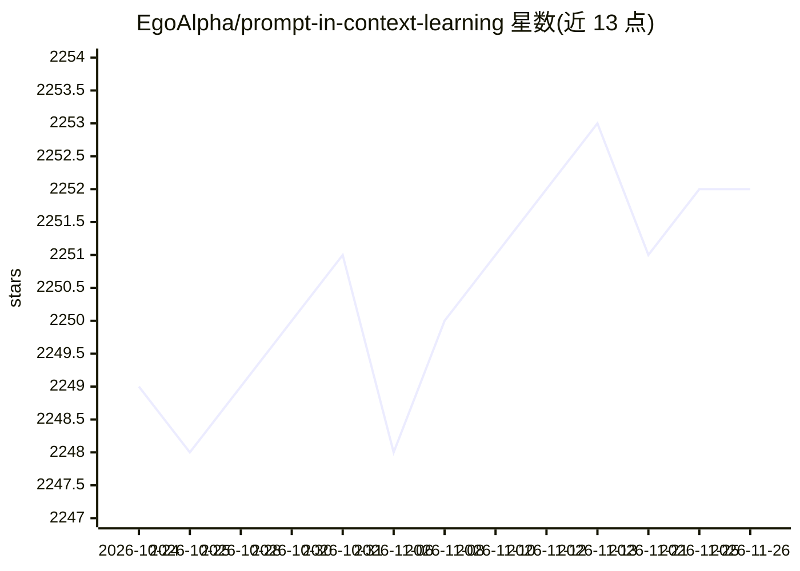

# EgoAlpha/prompt-in-context-learning

⭐ 2,252 · Jupyter Notebook · MIT · 推送 2026-11-25 · [GitHub](https://github.com/EgoAlpha/prompt-in-context-learning) · [官网](https://egoalpha.com) · 组织维护

**面向 LLM 学习者的上下文学习与提示工程论文/教程资源清单**

EgoAlpha Lab 维护的 awesome 类资源仓库，每日更新收录关于 In-Context Learning、Prompt Engineering、Agent 与基础模型的论文，按 Survey、Prompt Design、Chain of Thought、In-context Learning、RAG、Evaluation、Agent、Multimodal Prompt 等分类组织，每类附完整论文列表链接。同时提供 LLM Playground 入口、提示工程技巧、ChatGPT 提示示例，以及基于 LangChain 的大模型快速上手指南。仓库本身为文档与链接聚合，不含可运行代码。

## 筛选速览

| 维度 | 判定 | 备注 |
|---|---|---|
| AI 角色 | `ai-knowledge` | 知识聚合/清单类 |
| 许可风险 | `permissive` | MIT |
| 部署形态 | `None` |  |
| 模型依赖 | — | README 未给出锁定关系 |
| 硬件要求 | — | 无带数字的原话,不猜 |
| 安装摩擦 | `low` | 无编译、无系统依赖或容器化 |
| 成熟度 | — | 结构信号不足 |

## 能力要点

- 按 Survey/Prompt Design/CoT/In-context Learning/RAG/Evaluation/Agent/多模态等分类组织的论文清单
- 含 AI Spotlight 每日更新论文板块
- 提供 LLM Playground 提示实验入口与 ChatGPT 提示示例
- 提供基于 LangChain 的大模型使用指南

## 适用场景

- 查找上下文学习与提示工程方向的最新论文
- 学习 Chain-of-Thought 等提示设计技术
- 通过示例提示词改进日常工作中的 ChatGPT 使用
- 借助 LangChain 指南快速上手大模型

## 场景标签

`精选清单` `教程课程` · 领域:学习与行业

## 证据(README 行号)

> L3: **An Open-Source Engineering Guide for Prompt-in-context-learning from EgoAlpha Lab.**
> L18: *🎉Papers🎉*: The latest papers about *In-Context Learning*, *Prompt Engineering*, *Agent*, and *Foundation Models*.
> L76: # 📜 Papers

## 星数曲线

2026-10-24 2,249 → 2026-11-26 2,252（+3）

---
*卡片 v1 · prompt 1.4 · 生成 2026-11-26 · 置信度 high · 依据 README sha `9d26eff21c9b` · [字段定义](../../DATASET.md)*
