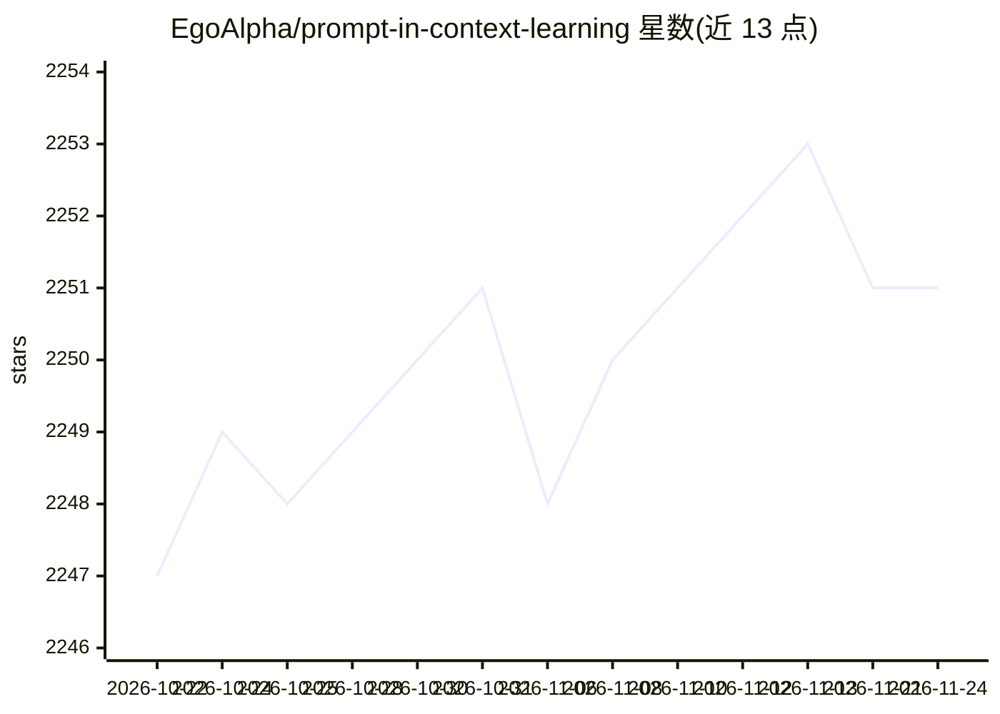

# EgoAlpha/prompt-in-context-learning

⭐ 2,251 · Jupyter Notebook · MIT · 推送 2026-11-22 · [GitHub](https://github.com/EgoAlpha/prompt-in-context-learning) · [官网](https://egoalpha.com) · 组织维护

**学习者的上下文学习与提示工程资源清单**

EgoAlpha Lab 维护的 Awesome 类资源聚合仓库，收录 In-Context Learning、Prompt Engineering、Agent、Foundation Models 相关论文，按 Survey、Prompt Design、Chain of Thought、RAG、Evaluation、Agent、Multimodal Prompt、应用等类别组织，每条附 arXiv 链接与日期。另设有 Playground（提示实验用 LLM）、ChatGPT Prompt 示例、以及基于 LangChain 的 LLM 使用入门指南，宣称每日更新。

## 筛选速览

| 维度 | 判定 | 备注 |
|---|---|---|
| AI 角色 | `ai-knowledge` | 知识聚合/清单类 |
| 许可风险 | `permissive` | MIT |
| 部署形态 | `None` |  |
| 模型依赖 | — | README 未给出锁定关系 |
| 硬件要求 | — | 无带数字的原话,不猜 |
| 安装摩擦 | `low` | 无编译、无系统依赖或容器化 |
| 成熟度 | — | 结构信号不足 |

## 能力要点

- 按 Survey/Prompt Design/CoT/ICL/RAG/评估/Agent/多模态等类别组织的论文清单
- 每条论文附 arXiv 链接与发表日期
- 提供 ChatGPT Prompt 示例与基于 LangChain 的 LLM 入门指南
- 设有 AI Spotlight 板块跟踪最新研究论文

## 适用场景

- 查找上下文学习与提示工程方向的论文入口
- 按主题浏览 CoT、RAG、多模态提示等研究进展
- 获取可直接套用的 ChatGPT 提示示例

## 场景标签

`提示工程` `精选清单` · 领域:Agent 开发

## 证据(README 行号)

> L3: **An Open-Source Engineering Guide for Prompt-in-context-learning from EgoAlpha Lab.**
> L16: The resources include:
> L18: *🎉Papers🎉*: The latest papers about *In-Context Learning*, *Prompt Engineering*, *Agent*, and *Foundation Models*.

## 星数曲线

2026-10-22 2,247 → 2026-11-24 2,251（+4）

---
*卡片 v1 · prompt 1.4 · 生成 2026-11-23 · 置信度 high · 依据 README sha `c48f145fa628` · [字段定义](../../DATASET.md)*
