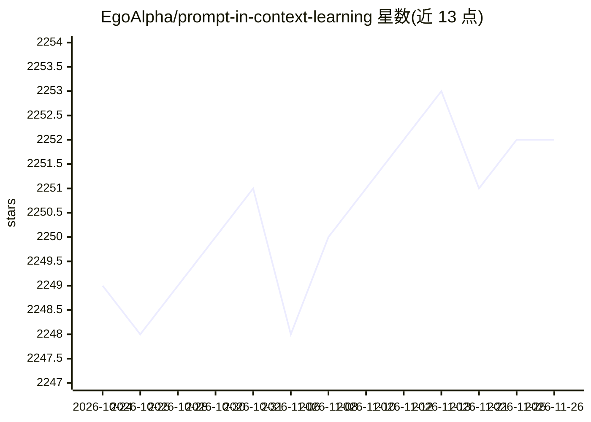

# EgoAlpha/prompt-in-context-learning

⭐ 2,252 · Jupyter Notebook · MIT · 推送 2026-11-25 · [GitHub](https://github.com/EgoAlpha/prompt-in-context-learning) · [官网](https://egoalpha.com) · 组织维护

**面向学习者与开发者的上下文学习与提示工程论文/教程资源清单**

EgoAlpha Lab 维护的 Awesome 类资源聚合仓库，收录 In-Context Learning、Prompt Engineering、Agent、Foundation Models 等方向的论文链接，按 Survey、Prompt Design、Chain of Thought、RAG、Evaluation、Agent、Multimodal Prompt 等类别组织，并附 ChatGPT 提示示例、提示实验 Playground 入口与基于 LangChain 的大模型上手指南，README 标注每日更新。

## 筛选速览

| 维度 | 判定 | 备注 |
|---|---|---|
| AI 角色 | `ai-knowledge` | 知识聚合/清单类 |
| 许可风险 | `permissive` | MIT |
| 部署形态 | `None` |  |
| 模型依赖 | — | README 未给出锁定关系 |
| 硬件要求 | — | 无带数字的原话,不猜 |
| 安装摩擦 | `low` | 无编译、无系统依赖或容器化 |
| 成熟度 | — | 结构信号不足 |

## 能力要点

- 论文按 Survey/Prompt Design/Chain of Thought/RAG/Evaluation/Agent 等类别分节收录
- 提供 ChatGPT 提示示例与可做提示实验的 Playground 资源入口
- 包含基于 LangChain 快速上手大语言模型的使用指南
- README 标注每日更新的 AI Spotlight 论文板块

## 适用场景

- 查找上下文学习与思维链方向的相关论文
- 为工作与日常场景参考可复用的 ChatGPT 提示示例
- 借助 LangChain 指南入门大语言模型使用

## 场景标签

`精选清单` `教程课程` `提示工程` · 领域:Agent 开发

## 证据(README 行号)

> L18: *🎉Papers🎉*: The latest papers about *In-Context Learning*, *Prompt Engineering*, *Agent*, and *Foundation Models*.
> L76: # 📜 Papers
> L104: ## Prompt Engineering

## 星数曲线

2026-10-24 2,249 → 2026-11-26 2,252（+3）

---
*卡片 v1 · prompt 1.4 · 生成 2026-11-24 · 置信度 high · 依据 README sha `960e3f39822a` · [字段定义](../../DATASET.md)*
