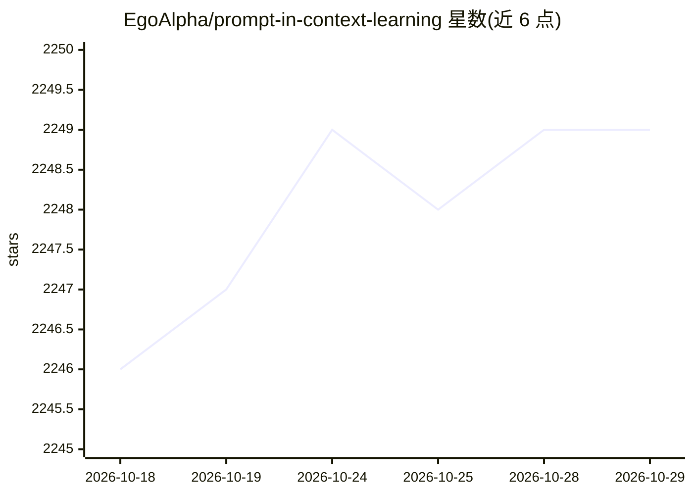

# EgoAlpha/prompt-in-context-learning

⭐ 2,249 · Jupyter Notebook · MIT · 推送 2026-10-28 · [GitHub](https://github.com/EgoAlpha/prompt-in-context-learning) · [官网](https://egoalpha.com) · 组织维护 · 中文 README

**上下文学习与提示工程的开源资源清单：论文、提示技术与LLM使用指南**

EgoAlpha Lab 维护的 Awesome 类资源汇编，按 Papers、Playground、Prompt Engineering、ChatGPT Prompt、LLMs Usage Guide 五类组织内容。论文部分细分为 Survey、Prompt Design、Chain of Thought、In-context Learning、RAG、Evaluation & Reliability、Agent、Multimodal Prompt 等主题，每类列出近期论文条目并提供完整列表外链；首页设每日更新的 Trending Research Papers 板块。LLMs Usage Guide 提到通过 LangChain 快速上手大模型的方法。资源以 Markdown 清单形式发布，无安装步骤。

## 筛选速览

| 维度 | 判定 | 备注 |
|---|---|---|
| AI 角色 | `ai-knowledge` | 知识聚合/清单类 |
| 许可风险 | `permissive` | MIT |
| 部署形态 | `None` |  |
| 模型依赖 | — | README 未给出锁定关系 |
| 硬件要求 | — | 无带数字的原话,不猜 |
| 安装摩擦 | `low` | 无编译、无系统依赖或容器化 |
| 成熟度 | — | 结构信号不足 |

## 能力要点

- 覆盖 In-context Learning、Prompt Engineering、Agent、Foundation Models 方向的论文清单
- 每日更新的 Trending Research Papers 板块（标注日期与作者）
- 包含 ChatGPT 提示词示例与基于 LangChain 的 LLM 使用指南
- 论文按 Survey/CoT/RAG/评测/Agent/多模态等十余个主题分类

## 适用场景

- 查找上下文学习与提示工程方向的最新论文
- 学习可直接复用的提示技术与 ChatGPT 提示词示例
- 按主题（CoT、RAG、Agent、多模态）跟踪 LLM 研究进展

## 场景标签

`精选清单` `提示工程` `科研工具` · 领域:Agent 开发

## 证据(README 行号)

> L3: **An Open-Source Engineering Guide for Prompt-in-context-learning from EgoAlpha Lab.**
> L16: The resources include:
> L18: *🎉Papers🎉*: The latest papers about *In-Context Learning*, *Prompt Engineering*, *Agent*, and *Foundation Models*.

## 星数曲线

2026-10-18 2,246 → 2026-10-29 2,249（+3）

---
*卡片 v1 · prompt 1.4 · 生成 2026-10-21 · 置信度 high · 依据 README sha `4a9f96469602` · [字段定义](../../DATASET.md)*
