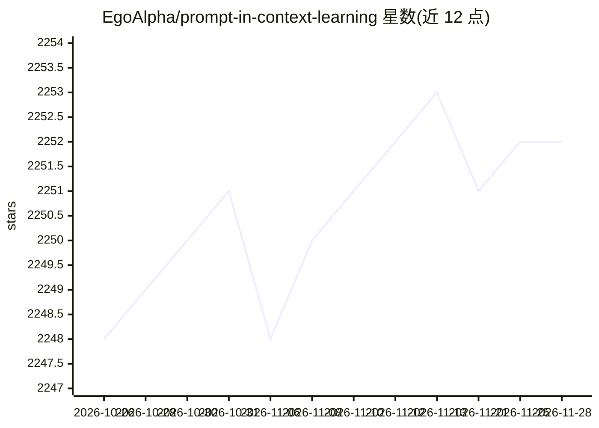

# EgoAlpha/prompt-in-context-learning

⭐ 2,252 · Jupyter Notebook · MIT · 推送 2026-11-27 · [GitHub](https://github.com/EgoAlpha/prompt-in-context-learning) · [官网](https://egoalpha.com) · 组织维护

**LLM 提示工程与上下文学习的论文/教程资源清单**

EgoAlpha Lab 维护的 Awesome 类资源聚合仓库：按 Survey、Prompt Engineering、Chain of Thought、In-context Learning、RAG、Evaluation、Agent、Multimodal Prompt 等分类整理论文条目，并每日更新 AI Spotlight 热门论文。资源还包括可试验提示词的 Playground、面向工作与生活的 ChatGPT Prompt 示例、以及通过 LangChain 快速上手大语言模型的用法指南。仓库本身不含可安装软件，内容以论文链接与提示词示例为主。

## 筛选速览

| 维度 | 判定 | 备注 |
|---|---|---|
| AI 角色 | `ai-knowledge` | 知识聚合/清单类 |
| 许可风险 | `permissive` | MIT |
| 部署形态 | `None` |  |
| 模型依赖 | — | README 未给出锁定关系 |
| 硬件要求 | — | 无带数字的原话,不猜 |
| 安装摩擦 | `low` | 无编译、无系统依赖或容器化 |
| 成熟度 | — | 结构信号不足 |

## 能力要点

- 按 ICL/CoT/RAG/Agent/多模态提示等类别组织的论文清单
- 每日更新的 AI Spotlight 热门论文栏目
- ChatGPT Prompt 示例与 Playground 提示试验资源
- 基于 LangChain 的 LLM 上手用法指南

## 适用场景

- 查找上下文学习与提示工程方向的最新论文
- 为工作或日常任务参考现成的 ChatGPT 提示示例
- 按类别了解 RAG、Agent 等领域的研究脉络

## 场景标签

`提示工程` `精选清单` `教程课程` · 领域:Agent 开发

## 证据(README 行号)

> L18: *🎉Papers🎉*: The latest papers about *In-Context Learning*, *Prompt Engineering*, *Agent*, and *Foundation Models*.
> L76: # 📜 Papers

## 星数曲线

2026-10-26 2,248 → 2026-11-28 2,252（+4）

---
*卡片 v1 · prompt 1.4 · 生成 2026-11-28 · 置信度 high · 依据 README sha `4dd239e57f15` · [字段定义](../../DATASET.md)*
