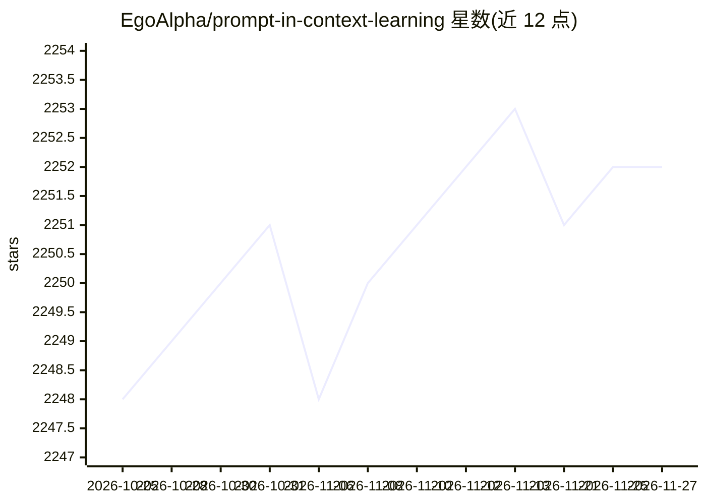

# EgoAlpha/prompt-in-context-learning

⭐ 2,252 · Jupyter Notebook · MIT · 推送 2026-11-26 · [GitHub](https://github.com/EgoAlpha/prompt-in-context-learning) · [官网](https://egoalpha.com) · 组织维护

**面向学习者的提示工程与上下文学习论文/资源清单**

EgoAlpha Lab 维护的 Awesome 资源聚合仓库，每日更新上下文学习（In-Context Learning）与提示工程相关的论文、提示技巧与入门指南。内容按 Survey、Prompt Engineering、Chain of Thought、In-context Learning、RAG、Evaluation、Agent、Multimodal Prompt 等分类组织，每条含论文标题与日期并链接到 PDF；另含 ChatGPT 提示示例与基于 LangChain 的大模型使用指南、可做提示实验的 Playground 板块。仓库本身不提供模型或代码运行环境，属于学习与文献检索入口。

## 筛选速览

| 维度 | 判定 | 备注 |
|---|---|---|
| AI 角色 | `ai-knowledge` | 知识聚合/清单类 |
| 许可风险 | `permissive` | MIT |
| 部署形态 | `None` |  |
| 模型依赖 | — | README 未给出锁定关系 |
| 硬件要求 | — | 无带数字的原话,不猜 |
| 安装摩擦 | `low` | 无编译、无系统依赖或容器化 |
| 成熟度 | — | 结构信号不足 |

## 能力要点

- 按 Survey/Prompt Engineering/CoT/RAG/Agent 等多类别组织的论文清单，每条附日期与 arXiv 链接
- 每日更新的 AI Spotlight 趋势论文板块
- 包含 ChatGPT 提示示例与基于 LangChain 的 LLM 使用指南
- 提供用于提示实验的 Playground 板块

## 适用场景

- 查找上下文学习与提示工程方向的最新论文
- 学习各类提示技巧与思维链示例
- 获取可直接套用到日常工作中的 ChatGPT 提示模板
- 通过 LangChain 指南快速上手大模型开发

## 场景标签

`精选清单` `教程课程` `提示工程` · 领域:Agent 开发

## 证据(README 行号)

> L3: **An Open-Source Engineering Guide for Prompt-in-context-learning from EgoAlpha Lab.**
> L18: *🎉Papers🎉*: The latest papers about *In-Context Learning*, *Prompt Engineering*, *Agent*, and *Foundation Models*.
> L76: # 📜 Papers

## 星数曲线

2026-10-25 2,248 → 2026-11-27 2,252（+4）

---
*卡片 v1 · prompt 1.4 · 生成 2026-11-27 · 置信度 high · 依据 README sha `a5786a8833ff` · [字段定义](../../DATASET.md)*
