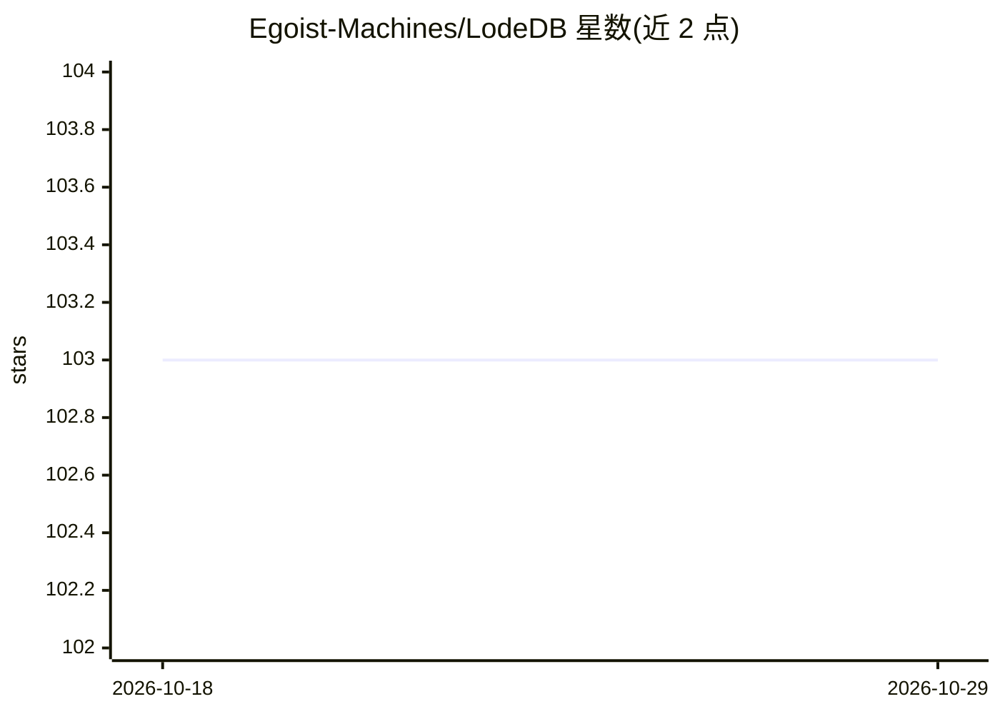

# Egoist-Machines/LodeDB

⭐ 103 · Python · Apache-2.0 · 推送 2026-10-18 · [GitHub](https://github.com/Egoist-Machines/LodeDB) · 组织维护

**面向本地 RAG 的进程内嵌入式向量数据库，支持 GPU 与多模态**

Apache-2.0 许可的嵌入式向量数据库，由 Egoist Machines, Inc. 维护。进程内运行、数据落盘，默认精确检索；提供 BM25+向量的混合检索（RRF 融合）、GPU 常驻批量扫描（Linux/CUDA）、增量持久化提交、2/4-bit 压缩存储。内置本地嵌入（ONNX Runtime 默认、PyTorch 回退），支持 CLIP 图文共享空间的多模态索引。附带 CLI、开发服务器、MCP 服务器，以及 LangChain/LlamaIndex/mem0/cognee/PrivateGPT 适配器，另有 Swift/iOS 绑定。提供从 pgvector 等现有存储的非破坏性迁移工具。企业许可另行提供。

## 筛选速览

| 维度 | 判定 | 备注 |
|---|---|---|
| AI 角色 | `ai-ecosystem` | LLM/agent 周边工具 |
| 许可风险 | `permissive` | Apache-2.0 |
| 部署形态 | `library` | 以包/库形式分发 |
| 模型依赖 | — | README 未给出锁定关系 |
| 硬件要求 | `cpu-ok` | |
| 安装摩擦 | `medium` | 含编译或系统依赖之一 |
| 成熟度 | — | 结构信号不足 |

## 能力要点

- 进程内、落盘、默认精确检索的嵌入式向量数据库，无守护进程与 API key
- BM25+向量混合检索为默认模式（RRF 融合）
- GPU 常驻批量扫描（Linux/CUDA，cuBLAS GEMM + top-k）
- 内置本地嵌入（ONNX/PyTorch 回退）与 CLIP 图文多模态索引
- 提供 LangChain/LlamaIndex/mem0 适配器、MCP 服务器与 Swift/iOS 绑定

## 适用场景

- 为 RAG 应用提供本地落盘的向量与混合检索后端
- 把 LangChain/LlamaIndex/mem0 的存储后端替换为本地嵌入式存储
- 在 iOS/macOS 应用内做端上向量与文本检索
- 通过 MCP 为编码助手提供本地记忆存储

## 场景标签

`向量数据库` · 领域:知识与检索

## 证据(README 行号)

> L10: LodeDB is great for local RAG; it's _extremely fast_, exact by default, in-process, and on-disk. We're the **best d
> L54: - **In-process, on-disk** (`.tvim`/`.tvd`/`.jsd`): no daemon, no account, no API key.
> L68:  MCP server, LangChain, LlamaIndex, and mem0 adapters

## 星数曲线

2026-10-18 103 → 2026-10-29 103（+0）

---
*卡片 v1 · prompt 1.4 · 生成 2026-10-23 · 置信度 high · 依据 README sha `984eff3015a5` · [字段定义](../../DATASET.md)*
