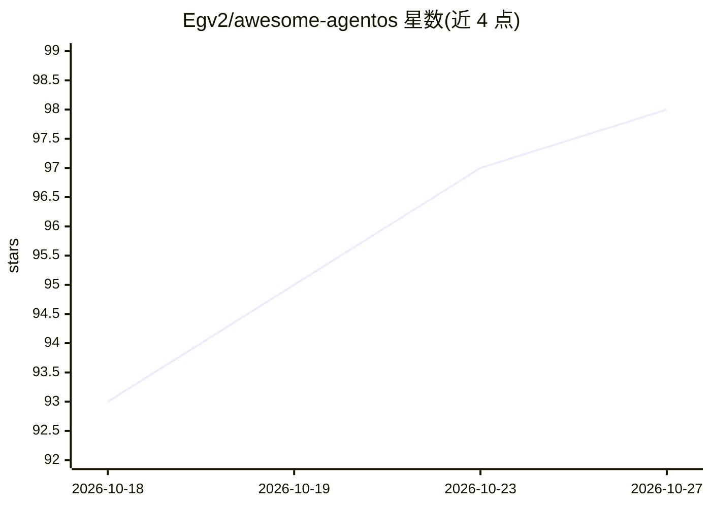

# Egv2/awesome-agentos

⭐ 98 · CC0-1.0 · 推送 2026-09-30 · [GitHub](https://github.com/Egv2/awesome-agentos) · 个人维护

**面向自主计算的 AgentOS/AI agent 开源项目策展清单**

一个 awesome 风格的策展清单，收录构建 agentic 操作系统、AI agent 与自主计算工具相关的开源项目。内容按七大类组织：Agent 框架与编排、桌面/计算机使用自动化、Web agent 与浏览器自动化、语音与对话 AI、视觉与创作 AI、开发者工具与编码助手、LLM 基础设施与模型服务，另含安全攻防章节；每个条目为一句话简介。面向希望选型与了解 agent 生态的开发者，仓库本身不提供可运行代码。

## 筛选速览

| 维度 | 判定 | 备注 |
|---|---|---|
| AI 角色 | `ai-knowledge` | 知识聚合/清单类 |
| 许可风险 | `viral` | CC0-1.0 |
| 部署形态 | `None` |  |
| 模型依赖 | — | README 未给出锁定关系 |
| 硬件要求 | — | 无带数字的原话,不猜 |
| 安装摩擦 | `low` | 无编译、无系统依赖或容器化 |
| 成熟度 | — | 结构信号不足 |

## 能力要点

- 按 7+ 个类别组织 agent 生态开源项目条目
- 覆盖框架、桌面自动化、浏览器 agent、语音、视觉、编码助手与 LLM 基础设施
- 每个条目附一句话功能描述

## 适用场景

- 为构建 agent 应用挑选框架或运行时
- 了解计算机使用与浏览器自动化 agent 的开源选项
- 按类别浏览语音/视觉/编码等方向的 AI 开源项目

## 场景标签

`精选清单` · 领域:学习与行业

## 证据(README 行号)

> L1: # Awesome AgentOS Awesome
> L7: ## Agent Frameworks & Orchestrators
> L9: Frameworks for building, deploying, and managing multi-agent systems.

## 星数曲线

2026-10-18 93 → 2026-10-27 98（+5）

---
*卡片 v1 · prompt 1.4 · 生成 2026-10-23 · 置信度 high · 依据 README sha `17b92d34ae86` · [字段定义](../../DATASET.md)*
