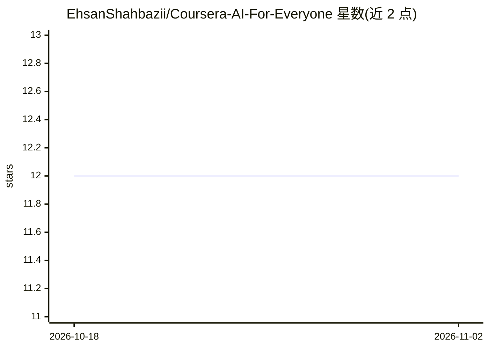

# EhsanShahbazii/Coursera-AI-For-Everyone

⭐ 12 · Brainfuck · 推送 2026-10-07 · [GitHub](https://github.com/EhsanShahbazii/Coursera-AI-For-Everyone) · [官网](https://www.coursera.org/learn/ai-for-everyone) · 个人维护

**AI For Everyone 课程笔记与证书的归档仓库**

个人学习仓库，收录 Coursera「AI For Everyone」课程（DeepLearning.AI 提供）的笔记与结业证书链接。README 极简：包含课程简介、Week 1 介绍章节的英文/波斯语笔记条目引用，以及证书部分。仓库本体不含代码、工具或可安装内容，仅作为课程学习记录与笔记存放。

## 筛选速览

| 维度 | 判定 | 备注 |
|---|---|---|
| AI 角色 | `ai-knowledge` | 知识聚合/清单类 |
| 许可风险 | `none` | — |
| 部署形态 | `None` |  |
| 模型依赖 | — | README 未给出锁定关系 |
| 硬件要求 | — | 无带数字的原话,不猜 |
| 安装摩擦 | `low` | 无编译、无系统依赖或容器化 |
| 成熟度 | — | 结构信号不足 |

## 能力要点

- 收录课程 Week 1 介绍笔记（英文与波斯语两种语言）
- 包含结业证书展示与链接
- 对应 DeepLearning.AI 的 AI For Everyone 课程

## 适用场景

- 查阅 AI For Everyone 课程的个人笔记
- 参考非技术人员 AI 通识课的学习内容组织方式

## 场景标签

 · 领域:AI 教育/学习笔记

## 证据(README 行号)

> L5: Coursera-AI-For-Everyone
> L15: - ### Week 1 Introduction
> L16:  - 1-introduction-note-fa

## 星数曲线

2026-10-18 12 → 2026-11-02 12（+0）

---
*卡片 v1 · prompt 1.4 · 生成 2026-11-01 · 置信度 high · 依据 README sha `0ef67b19dc61` · [字段定义](../../DATASET.md)*
