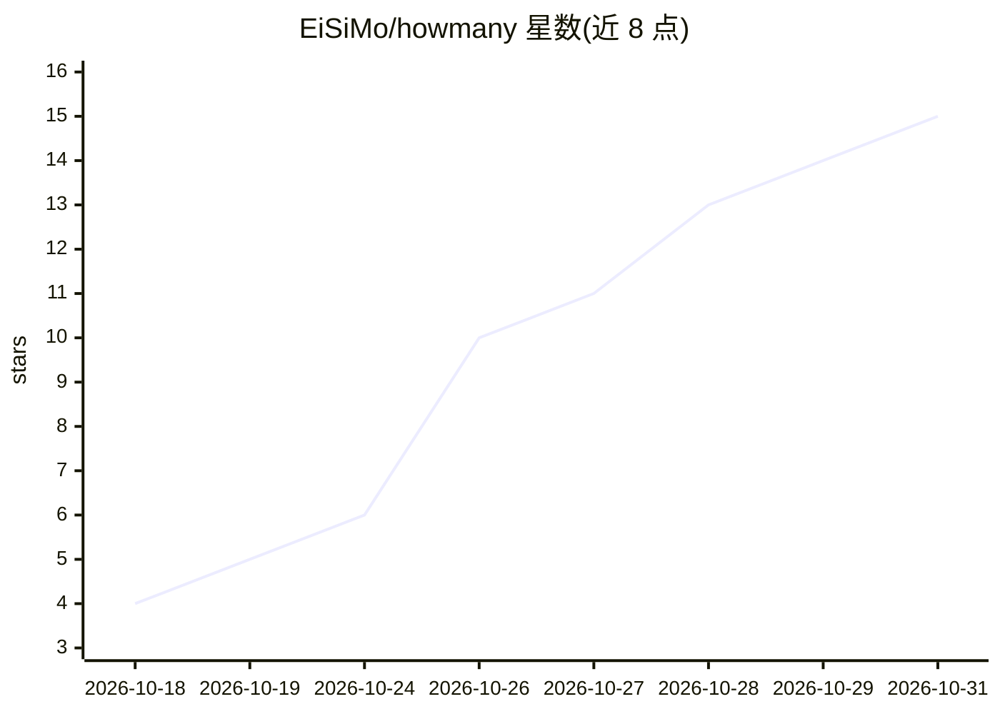

# EiSiMo/howmany

⭐ 15 · Kotlin · MIT · 推送 2026-10-27 · [GitHub](https://github.com/EiSiMo/howmany) · 个人维护

**离线照片物体计数的 Android 应用：框选一个即可数同类**

Android 端少样本物体计数应用：拍照或从相册选图后框选一个目标，应用即标记并统计照片中所有同类物体（如硬币、窗户、鸟群），全部计算在手机本地完成，应用无联网权限，照片不出设备。计数模型为 GeCo2（基于 SAM 2 图像编码器），经 ONNX Runtime 在手机上运行。结果可校验：可拖动边界限定区域、点选增删修正计数。构建需 JDK 21 与 Android SDK；提供 GitHub、F-Droid 与 Google Play 渠道。

## 筛选速览

| 维度 | 判定 | 备注 |
|---|---|---|
| AI 角色 | `ai-native` | 本体是模型或模型工具 |
| 许可风险 | `permissive` | MIT |
| 部署形态 | `None` |  |
| 模型依赖 | — | README 未给出锁定关系 |
| 硬件要求 | — | 无带数字的原话,不猜 |
| 安装摩擦 | `medium` | 含编译或系统依赖之一 |
| 成熟度 | — | 结构信号不足 |

## 能力要点

- 框选单个目标即可计数照片中全部同类物体
- 完全离线运行，应用无联网权限，照片不出设备
- 计数结果可手动校验（限定区域、点选增删）
- 基于 GeCo2 模型，ONNX Runtime 手机端推理

## 适用场景

- 清点货架、零件、药片等大量重复物体
- 统计照片中的人群、鸟类等群体数量
- 在无网络环境下离线计数且不上传照片

## 场景标签

`目标检测` · 领域:感知与多模态

## 证据(README 行号)

> L5:  An Android app that counts objects in a photo, fully offline and open source.
> L66: looks like it. Everything runs on your phone. The app has no internet permission, so

## 星数曲线

2026-10-18 4 → 2026-10-31 15（+11）

---
*卡片 v1 · prompt 1.4 · 生成 2026-10-31 · 置信度 high · 依据 README sha `dc7275f92083` · [字段定义](../../DATASET.md)*
