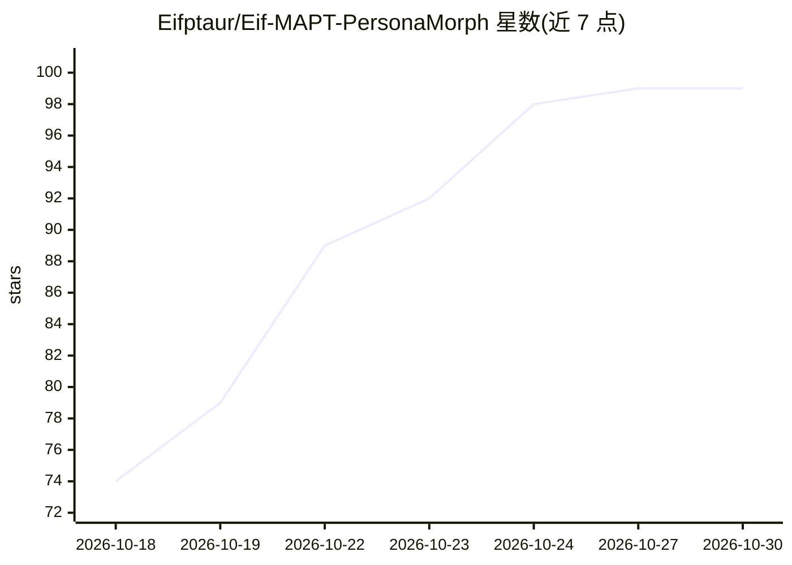

# Eifptaur/Eif-MAPT-PersonaMorph

⭐ 99 · Python · NOASSERTION · 推送 2026-10-10 · [GitHub](https://github.com/Eifptaur/Eif-MAPT-PersonaMorph) · [官网](https://github.com/Eifptaur/Eif-MAPT-PersonaMorph/releases/latest) · 个人维护 · 中文 README

**本地运行的微信群聊 AI 人设机器人，按角色口吻自动回群消息**

Windows 桌面应用（PySide6 控制台，27 个面板）：读取本机微信数据库与界面自动化，让接入的 OpenAI 兼容模型 API 以指定人设在微信群/QQ 群回复。消息/图片/表情走后台投递不动鼠标；提供七字段人设卡库、群友印象与事实抽取记忆、主动开话题、语音条合成、B 站/视频理解、插件式 Skill 与工具及资源市场。数据默认留本机，仅本轮必要片段发往用户自配的模型 API；需微信 4.x 已登录，Windows 10/11 64 位。

## 筛选速览

| 维度 | 判定 | 备注 |
|---|---|---|
| AI 角色 | `ai-native` | 本体是模型或模型工具 |
| 许可风险 | `none` | NOASSERTION |
| 部署形态 | `desktop` | 安装包/桌面程序 |
| 模型依赖 | — | README 未给出锁定关系 |
| 硬件要求 | — | 无带数字的原话,不猜 |
| 安装摩擦 | `low` | 无编译、无系统依赖或容器化 |
| 成熟度 | `idea` | |

## 能力要点

- 七字段人设卡库与多人设切换、@角色分流
- 记忆系统：群友印象、带时效的事实抽取、待跟进、亲近度
- 发消息/发图/切会话走后台投递，不动鼠标、不要求微信窗口可见
- 人设/Skill/工具皆插件，支持热重载与资源市场下载上传

## 适用场景

- 给微信群部署一个按设定角色说话的 AI 机器人
- 用自己的人设卡和模型 API Key 在本机运行群聊助手
- 让机器人主动开话题、跟进约定事项、纪念日提醒

## 场景标签

`聊天机器人` · 领域:对话与助手

## 证据(README 行号)

> L7: 群相是一个装在你自己电脑上的群聊 AI 机器人。给它一个人设——一个角色、一位历史人物、一个你自创的性格——它就以那个人的口吻在你的微信群/QQ 群里说话：接梗、吐槽、记得住人、认得出谁在跟它说话，该回的时候回，不该回的时候闭嘴。
> L57: - **多模型**：任何 OpenAI 兼容接口都能用，官方、中转站、本地模型都行。

## 星数曲线

2026-10-18 74 → 2026-10-30 99（+25）

---
*卡片 v1 · prompt 1.4 · 生成 2026-10-23 · 置信度 high · 依据 README sha `6dd8294881fe` · [字段定义](../../DATASET.md)*
