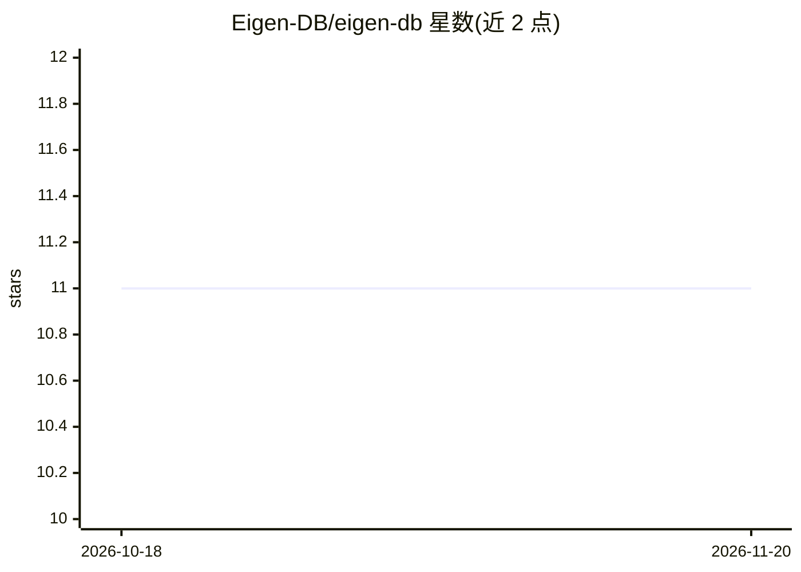

# Eigen-DB/eigen-db

⭐ 11 · Go · GPL-3.0 · 推送 2026-09-30 · [GitHub](https://github.com/Eigen-DB/eigen-db) · [官网](https://eigendb.sh) · 个人维护

**面向 AI 应用开发者的内存向量数据库**

EigenDB 是用 Go 编写的轻量级开源内存向量数据库，使用 HNSW 算法（由其 Go 库 faissgo 实现）进行向量检索，支持 KNN 查询。通过 REST API 提供服务，并提供 Python SDK 供 Python 应用集成。README 中贡献指南标注为“即将推出”，文档位于外部站点，未包含安装命令或使用示例。

## 筛选速览

| 维度 | 判定 | 备注 |
|---|---|---|
| AI 角色 | `ai-ecosystem` | LLM/agent 周边工具 |
| 许可风险 | `viral` | GPL-3.0 |
| 部署形态 | `None` |  |
| 模型依赖 | — | README 未给出锁定关系 |
| 硬件要求 | — | 无带数字的原话,不猜 |
| 安装摩擦 | `low` | 无编译、无系统依赖或容器化 |
| 成熟度 | — | 结构信号不足 |

## 能力要点

- Go 实现的内存向量数据库，基于 HNSW 算法
- 提供简单 REST API
- 提供 Python SDK 供 Python 应用集成
- HNSW 逻辑由开源 Go 库 faissgo 处理

## 适用场景

- 为 AI 应用存储和检索向量嵌入
- 在 Python 应用中通过 SDK 集成向量检索
- 通过 REST API 访问内存向量存储

## 场景标签

`向量数据库` · 领域:知识与检索

## 证据(README 行号)

> L23: * EigenDB is a light-weight in-memory vector database written in Go. It’s also open-source ❤️
> L26: * Features a simple REST API. ✨
> L27: * Can seamlessly be integrated into your Python applications using our Python SDK. 🐍

## 星数曲线

2026-10-18 11 → 2026-11-20 11（+0）

---
*卡片 v1 · prompt 1.4 · 生成 2026-11-19 · 置信度 mid · 依据 README sha `261985196de9` · [字段定义](../../DATASET.md)*
