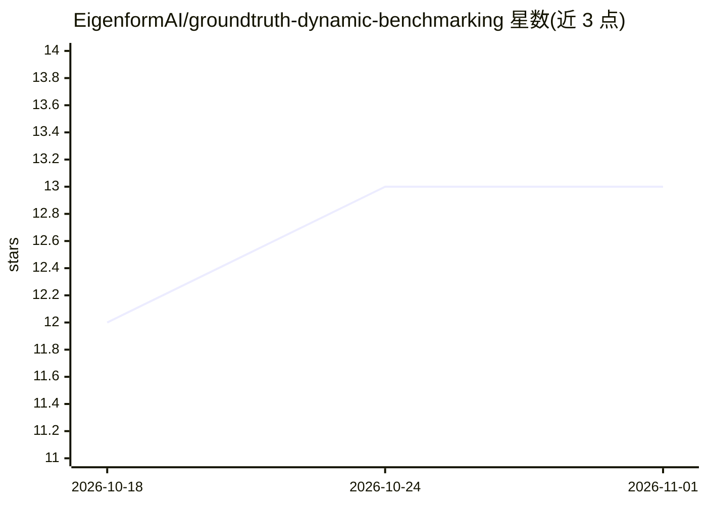

# EigenformAI/groundtruth-dynamic-benchmarking

⭐ 13 · Python · MIT · 推送 2026-10-26 · [GitHub](https://github.com/EigenformAI/groundtruth-dynamic-benchmarking) · [官网](https://eigenform.ai/benchmark/) · 组织维护

**地质领域 LLM 推理评测基准与打分工具链**

面向地质推理的开源领域基准：从真实地质一手资料（矿产勘查报告、政府地质档案、技术文件）生成题目与源锚定评分量表，候选模型作答后由独立固定 judge 模型（openai/gpt-5.5）逐题打 0–10 分，结果进入在线榜单。两阶段流程（生成/评分）分离，支持 pointwise 与顺序交换的 pairwise 模式；评测 harness 本身领域无关，可运行任意 schema-2.0 量表。通过 uv 安装，生成阶段可创建 RunPod GPU pod 运行，OpenRouter 候选无需 GPU。供 AI/ML 研究者、地质学家与领域 AI 团队评测模型。

## 筛选速览

| 维度 | 判定 | 备注 |
|---|---|---|
| AI 角色 | `ai-ecosystem` | LLM/agent 周边工具 |
| 许可风险 | `permissive` | MIT |
| 部署形态 | `None` |  |
| 模型依赖 | local-ok | 支持本地模型 |
| 硬件要求 | — | 无带数字的原话,不猜 |
| 安装摩擦 | `low` | 无编译、无系统依赖或容器化 |
| 成熟度 | — | 结构信号不足 |

## 能力要点

- 从开源许可的一手地质记录生成题目与源锚定 rubric，可随语料刷新再生
- 独立 judge 逐题 0–10 打分，pointwise 与去位置偏差的 pairwise 两种模式
- eval harness 领域无关，可运行任意 schema-2.0 rubric
- 榜单含模型轨道与固定模型的 harness 轨道

## 适用场景

- 评测微调地球科学模型是否真有地质推理能力
- 对比检索/agent 框架在同一模型下的效果（harness 轨道）
- 为地质工作挑选前沿模型
- 为新领域语料自建源锚定基准

## 场景标签

`模型评测` `科研工具` · 领域:评测与运维

## 证据(README 行号)

> L3: **An Earth Sciences AI benchmark.** Groundtruth is a domain-specific LLM benchmark for **geological reasoning**: it 
> L32: Groundtruth Dynamic Benchmarking is an open-source AI benchmark for geological reasoning. It measures whether a lan

## 星数曲线

2026-10-18 12 → 2026-11-01 13（+1）

---
*卡片 v1 · prompt 1.4 · 生成 2026-10-31 · 置信度 high · 依据 README sha `2524e36ca51c` · [字段定义](../../DATASET.md)*
