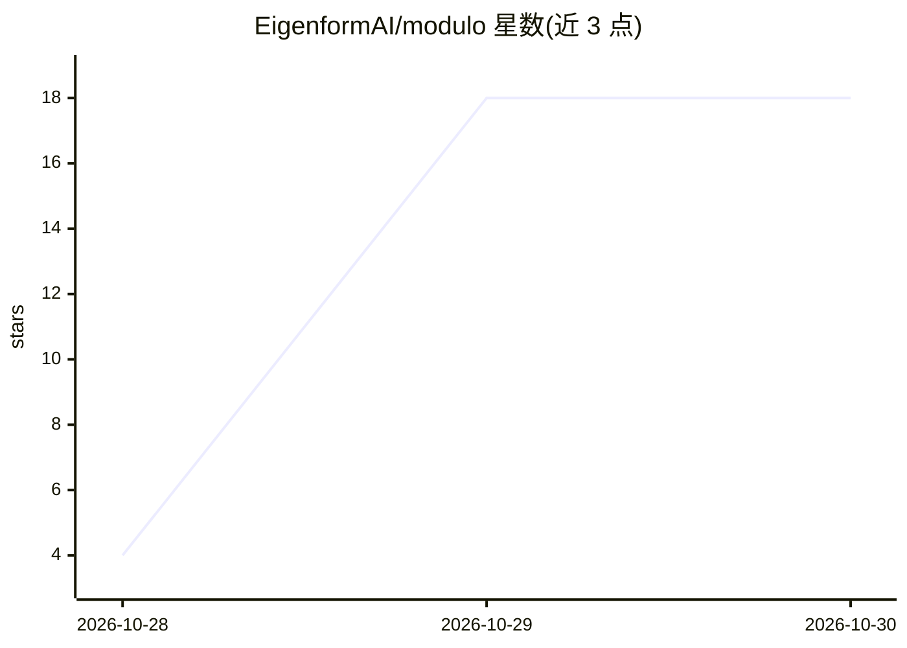

# EigenformAI/modulo

⭐ 18 · Python · 推送 2026-10-28 · [GitHub](https://github.com/EigenformAI/modulo) · [官网](https://www.eigenform.ai/ ) · 组织维护

**让本地模型 agent 在生成中转向自身激活的库**

面向运行本地开源权重模型的 agent：提供 steer(concept, strength) 工具，在生成过程中向残差流注入转向向量，改变内部状态；向量每轮按 0.85 倍衰减且可随时撤销，并带强度钳制、退化检测、kill switch 等安全机制。可作为库嵌入现有 agent harness（SteeringAgent，支持 HF 因果 LM 如 Llama/Qwen/Mistral 结构），也可运行独立 demo。向量来自社区索引（community/vectors.yaml，当前验证 Qwen2.5-7B-Instruct）或首启时用对比系统提示自动抽取。需 GPU（7B 需 24GB+ VRAM）、Python 3.10+、CUDA 12.x。

## 筛选速览

| 维度 | 判定 | 备注 |
|---|---|---|
| AI 角色 | `ai-ecosystem` | LLM/agent 周边工具 |
| 许可风险 | `none` | — |
| 部署形态 | `None` |  |
| 模型依赖 | — | README 未给出锁定关系 |
| 硬件要求 | `gpu-8g` | |
| 安装摩擦 | `medium` | 含编译或系统依赖之一 |
| 成熟度 | — | 结构信号不足 |

## 能力要点

- steer(concept, strength) 工具在生成时向残差流注入转向向量
- 向量每轮 0.85× 衰减，可撤销，最多 4 个活跃向量，含 kill switch 等安全机制
- 支持 HF 因果 LM（Llama/Qwen/Mistral 结构）的 SteeringAgent 库形式与独立 demo
- 缺失的启动向量可用对比系统提示自动抽取（数分钟）

## 适用场景

- 让本地模型 agent 在工作中试验调整自身的倾向或风格
- 研究激活转向对模型行为与生成的影响
- 为已有 agent harness 接入自转向能力

## 场景标签

`Agent 框架` · 领域:Agent 开发

## 证据(README 行号)

> L9: Modulo gives you a `steer(concept, strength)` tool that injects steering vectors into your residual stream during ge
> L11: Modulo is intended for local, open-weight models running in an environment that can expose the steering tool. If yo

## 星数曲线

2026-10-28 4 → 2026-10-30 18（+14）

---
*卡片 v1 · prompt 1.4 · 生成 2026-10-29 · 置信度 high · 依据 README sha `cc9e2af42bd9` · [字段定义](../../DATASET.md)*
