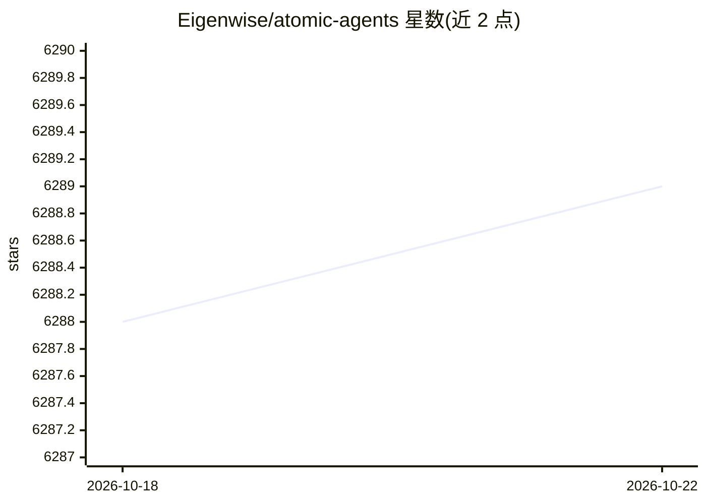

# Eigenwise/atomic-agents

⭐ 6,289 · Python · MIT · 推送 2026-10-21 · [GitHub](https://github.com/Eigenwise/atomic-agents) · [官网](https://eigenwise.github.io/atomic-agents/) · 组织维护

**面向开发者的轻量模块化 Python Agent 构建框架**

Atomic Agents 是一个基于 Instructor 与 Pydantic 的 Python 框架，以原子化组件（agent、tool、context provider、schema）方式构建 Agentic AI 应用。每个组件单一职责、可复用、可组合，通过输入/输出 schema 对齐实现 agent 与工具的链式编排与替换；所有控制流用 Python 编写。OpenAI SDK 默认内置，Groq/Anthropic/Gemini 等经 instructor extras 安装。附带 atomic-assembler CLI 下载 Atomic Forge 工具（搜索、计算器、PDF 读取等 16 种），并提供 quickstart 与 RAG、多模态、Deep Research 等示例工程。

## 筛选速览

| 维度 | 判定 | 备注 |
|---|---|---|
| AI 角色 | `ai-ecosystem` | LLM/agent 周边工具 |
| 许可风险 | `permissive` | MIT |
| 部署形态 | `library` | 以包/库形式分发 |
| 模型依赖 | local-ok | 支持本地模型 |
| 硬件要求 | — | 无带数字的原话,不猜 |
| 安装摩擦 | `low` | 无编译、无系统依赖或容器化 |
| 成熟度 | — | 结构信号不足 |

## 能力要点

- 原子化组件设计：单一职责、可复用、可组合的 agent/tool/context provider
- 基于 Instructor + Pydantic 的输入/输出 schema 对齐，实现 agent 与工具链式编排与替换
- atomic-assembler CLI 按需下载 Atomic Forge 工具（16 种，各自带 schema、示例与测试）
- 提供面向 AI 编码助手的 AGENTS.md、agent skills 与 LLM 文档包

## 适用场景

- 用熟悉的 Python 工程实践构建可控、输出结构化的 AI agent 应用
- 通过 schema 对齐把搜索、计算器等工具接入 agent 流水线并随时替换
- 参考 RAG 聊天机器人、Web 搜索 agent、YouTube 摘要等示例快速起步

## 场景标签

`Agent 框架` · 领域:Agent 开发

## 证据(README 行号)

> L19: The Atomic Agents framework is designed around the concept of atomicity to be an extremely lightweight and modular 
> L27: Built on Instructor and Pydantic, it enables you to create AI applications with the same software engineering princ
> L121: Atomic Agents makes it easy to chain agents and tools together by aligning their input and output schemas. This de

## 星数曲线

2026-10-18 6,288 → 2026-10-22 6,289（+1）

---
*卡片 v1 · prompt 1.4 · 生成 2026-10-20 · 置信度 mid · 依据 README sha `95c0e4974037` · [字段定义](../../DATASET.md)*
