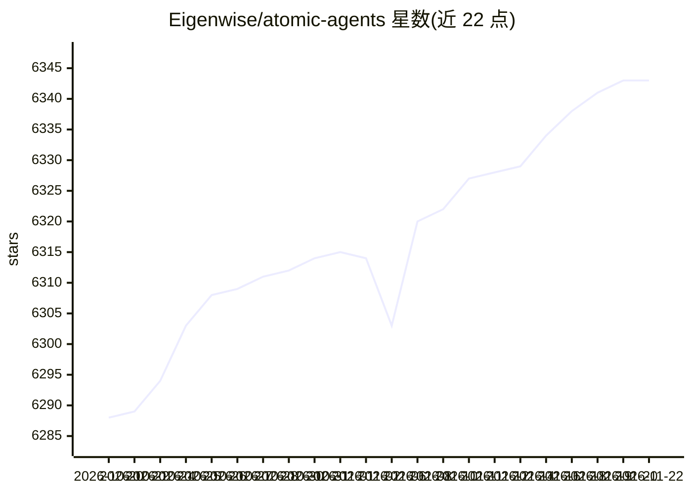

# Eigenwise/atomic-agents

⭐ 6,343 · Python · MIT · 推送 2026-11-17 · [GitHub](https://github.com/Eigenwise/atomic-agents) · [官网](https://eigenwise.github.io/atomic-agents/) · 个人维护

**给开发者构建 Agentic AI 应用的轻量模块化框架**

基于 Instructor 与 Pydantic 的 Python 框架，以原子化、模块化的组件（agent、tool、context provider）构建 Agentic AI 管线与应用；通过输入/输出 schema 对齐实现组件链式组合，支持运行时注入动态上下文，强调可预测性与可控性。附带 Atomic Assembler CLI 下载工具、OpenTelemetry 可观测性 extra，并为 AI 编码助手提供 AGENTS.md 与 agent skills。通过 pip 安装，MIT 许可。

## 筛选速览

| 维度 | 判定 | 备注 |
|---|---|---|
| AI 角色 | `ai-ecosystem` | LLM/agent 周边工具 |
| 许可风险 | `permissive` | MIT |
| 部署形态 | `library` | 以包/库形式分发 |
| 模型依赖 | local-ok | 支持本地模型 |
| 硬件要求 | — | 无带数字的原话,不猜 |
| 安装摩擦 | `low` | 无编译、无系统依赖或容器化 |
| 成熟度 | — | 结构信号不足 |

## 能力要点

- 原子化组件模型：单用途、可复用、可组合的 agent/tool/context provider
- 基于 Instructor 与 Pydantic 的 schema 对齐链式组合机制
- Context Provider 在运行时向 system prompt 注入动态上下文
- 每个 agent/tool 运行产生 OpenTelemetry span，兼容多种后端

## 适用场景

- 用可组合组件搭建 chatbot、RAG、web 搜索等 agent 应用
- 构建需要稳定输入输出 schema 的生产级 AI 管线
- 通过 Atomic Forge 工具集扩展搜索、抓取、摘要等能力
- 为 AI 编码助手提供框架知识与脚手架

## 场景标签

`Agent 框架` · 领域:Agent 开发

## 证据(README 行号)

> L21: The Atomic Agents framework is designed around the concept of atomicity to be an extremely lightweight and modular 
> L29: Built on Instructor and Pydantic, it enables you to create AI applications with the same software engineering princ
> L74: - **Modularity:** Build AI applications by combining small, reusable components.

## 星数曲线

2026-10-20 6,288 → 2026-11-22 6,343（+55）

---
*卡片 v1 · prompt 1.4 · 生成 2026-11-22 · 置信度 mid · 依据 README sha `2c66cab14e66` · [字段定义](../../DATASET.md)*
