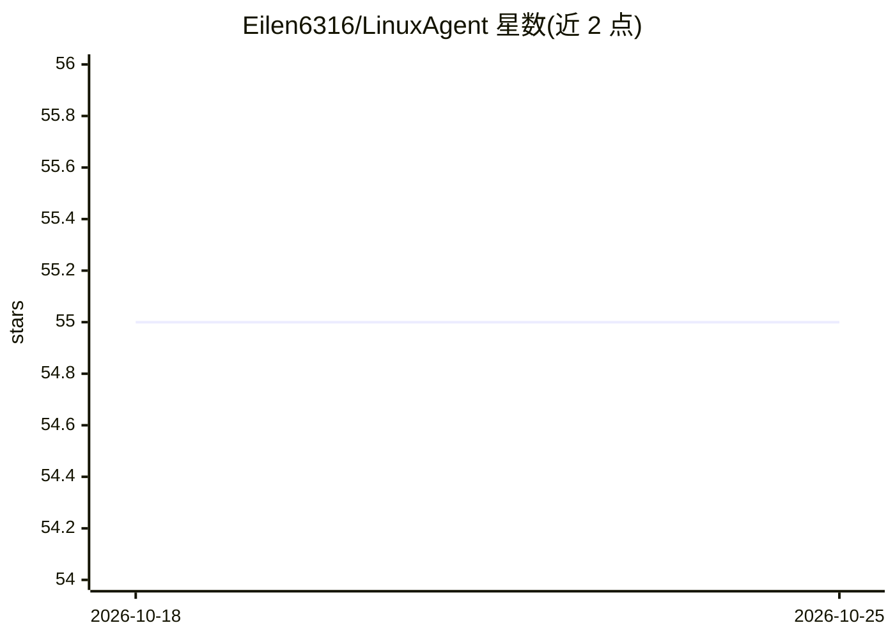

# Eilen6316/LinuxAgent

⭐ 55 · Python · 推送 2026-09-19 · [GitHub](https://github.com/Eilen6316/LinuxAgent) · 个人维护 · 中文 README

**LLM 提议 Linux 运维命令、经策略与人工确认后执行的 CLI**

面向运维操作者的 Linux 命令行助手：由 LLM 提议操作命令，命令先经基于能力（capability）的确定性策略引擎判定 SAFE/CONFIRM/BLOCK，首次生成的命令必须人工确认；工具输出在送回模型前做脱敏与截断，SSH 远程执行有已知主机校验、元字符拦截与批量确认，HITL 决策写入 0o600 哈希链审计日志。默认运行时为 Python v4，TypeScript v5 重写仍处实验阶段。通过源码脚本、GitHub Release wheel 或 PyPI 安装，支持 DeepSeek 与本地 Ollama 等提供方。

## 筛选速览

| 维度 | 判定 | 备注 |
|---|---|---|
| AI 角色 | `ai-native` | 本体是模型或模型工具 |
| 许可风险 | `none` | — |
| 部署形态 | `library` | 以包/库形式分发 |
| 模型依赖 | local-ok | 支持本地模型 |
| 硬件要求 | — | 无带数字的原话,不猜 |
| 安装摩擦 | `low` | 无编译、无系统依赖或容器化 |
| 成熟度 | `idea` | |

## 能力要点

- 能力策略引擎产出 SAFE/CONFIRM/BLOCK 判定与风险评分
- 首次 LLM 命令强制人工确认，破坏性命令永不进入会话白名单
- SSH 集群守卫：批量确认、远程元字符拦截、未知主机默认拒绝
- 哈希链审计日志，`linuxagent audit verify` 可检测篡改/截断/删除

## 适用场景

- 在受控环境让 LLM 辅助完成 Linux 运维操作且保留人工审批
- 对 SSH 多主机批量操作做逐次确认与审计
- 需要完整审计留痕的运维命令执行场景

## 场景标签

`AI 助手` · 领域:对话与助手

## 证据(README 行号)

> L10:  A Linux ops CLI where LLM-generated commands must pass deterministic policy and human approval before execution.
> L19: LinuxAgent is not a free-form shell chatbot and not an autonomous remediator. It

## 星数曲线

2026-10-18 55 → 2026-10-25 55（+0）

---
*卡片 v1 · prompt 1.4 · 生成 2026-10-24 · 置信度 high · 依据 README sha `494707cf6f19` · [字段定义](../../DATASET.md)*
