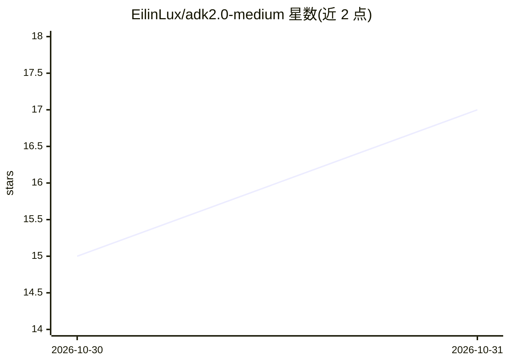

# EilinLux/adk2.0-medium

⭐ 17 · Python · NOASSERTION · 推送 2026-10-28 · [GitHub](https://github.com/EilinLux/adk2.0-medium) · [官网](https://medium.com/@ailluzdatascience/list/agent-developer-kit-adk-5d957c62e9a9 ) · 个人维护

**Google ADK 2.0 教程系列的配套实现仓库（SostaApp 示例）**

Medium 上 ADK 2.0 教程系列的代码实现仓库，每篇文章对应一个 Git 分支。以意大利高速公路服务区礼宾应用 SostaApp 为载体，演示从单一 LlmAgent（gemini-2.5-flash）到多 Agent 工作流、GraphWorkflow、Session/Memory 服务、Firestore 持久化、ADK 评测（adk eval）、工具 schema 与 MCP stdio server 的渐进式实现。面向跟随教程学习的 AI Agent 开发者，依赖 Google Cloud（Vertex AI、Firestore、BigQuery）。

## 筛选速览

| 维度 | 判定 | 备注 |
|---|---|---|
| AI 角色 | `ai-knowledge` | 知识聚合/清单类 |
| 许可风险 | `none` | NOASSERTION |
| 部署形态 | `self-host` | docker 或自建部署 |
| 模型依赖 | — | README 未给出锁定关系 |
| 硬件要求 | — | 无带数字的原话,不猜 |
| 安装摩擦 | `low` | 无编译、无系统依赖或容器化 |
| 成熟度 | — | 结构信号不足 |

## 能力要点

- 每篇 Medium 文章对应一个独立 Git 分支的代码快照
- SostaApp 多 Agent 示例：认证、路线规划、餐厅菜单与过敏原检查、EV 充电计算
- ADK 评测数据集与 adk eval CLI 的使用演示
- MCP stdio server 封装 BigQuery 地理空间查询

## 适用场景

- 跟随 Medium 系列文章逐步学习 Google ADK 2.0
- 参考多 Agent 工作流、Session/Memory 持久化与 MCP 集成的实现方式
- 了解 ADK agent 评测流程与 evalset 数据集格式

## 场景标签

`多智能体` `模型评测` `教程课程` · 领域:Agent 开发

## 证据(README 行号)

> L3: This repository contains the codebase and architecture blueprints for the **ADK 101** tutorial series published on M
> L8: The project demonstrates how to move away from fragile, notebook-bound AI prototypes and build production-grade, eve
> L44: To keep the codebase clean, isolated, and easy to follow, **each article in the Medium series corresponds to a dedi

## 星数曲线

2026-10-30 15 → 2026-10-31 17（+2）

---
*卡片 v1 · prompt 1.4 · 生成 2026-10-30 · 置信度 mid · 依据 README sha `71fcfe0195c5` · [字段定义](../../DATASET.md)*
