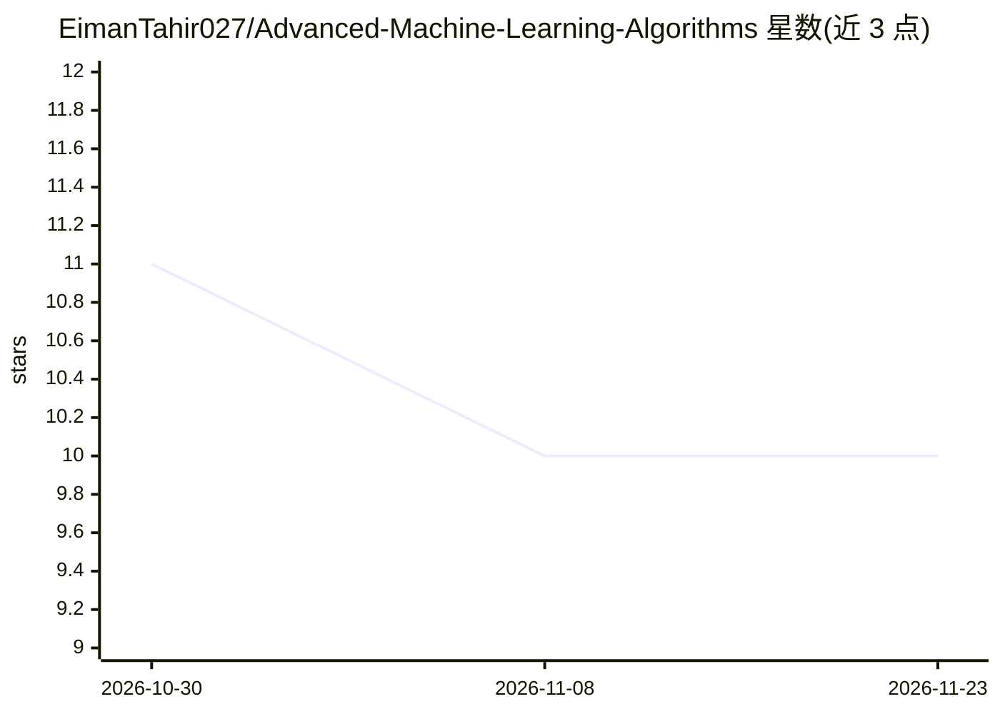

# EimanTahir027/Advanced-Machine-Learning-Algorithms

⭐ 10 · Python · MIT · 推送 2026-09-06 · [GitHub](https://github.com/EimanTahir027/Advanced-Machine-Learning-Algorithms) · 个人维护

**集成学习教程笔记本集：从 bagging 到梯度提升框架的系统学习**

以 Jupyter Notebook 组织的集成学习方法教程仓库，内容按 7 个模块递进：集成学习概念、Bagging 与随机森林、梯度提升、XGBoost、LightGBM/CatBoost、不均衡数据处理，最后以一个端到端项目在真实数据集上对比各模型的准确率、训练时间与不均衡类鲁棒性。技术栈为 Python 与 scikit-learn 等库，安装方式为 git clone 后 pip 安装依赖并启动 Jupyter，MIT 许可，接受 issue 与 PR 贡献。

## 筛选速览

| 维度 | 判定 | 备注 |
|---|---|---|
| AI 角色 | `ai-knowledge` | 知识聚合/清单类 |
| 许可风险 | `permissive` | MIT |
| 部署形态 | `library` | 以包/库形式分发 |
| 模型依赖 | — | README 未给出锁定关系 |
| 硬件要求 | — | 无带数字的原话,不猜 |
| 安装摩擦 | `low` | 无编译、无系统依赖或容器化 |
| 成熟度 | — | 结构信号不足 |

## 能力要点

- 7 个模块覆盖 bagging、boosting、随机森林到三大梯度提升框架
- 不均衡数据处理专题：重采样、类权重与评估指标
- 最终项目在真实数据集上对比各集成模型并做分析
- 从零实现与使用主流库两条实现路径

## 适用场景

- 系统学习集成学习与梯度提升算法原理及实现
- 查找不均衡数据集的处理与评估方法示例
- 参考真实数据集上多模型对比的完整项目流程

## 场景标签

`教程课程` · 领域:学习与行业

## 证据(README 行号)

> L3: A structured, hands-on collection of notebooks and resources covering ensemble learning methods in machine learning 
> L7: ## 📚 Contents
> L17: |7|**Ensemble Learning Project**|End-to-end project comparing ensemble models on a real-world dataset|

## 星数曲线

2026-10-30 11 → 2026-11-23 10（-1）

---
*卡片 v1 · prompt 1.4 · 生成 2026-11-20 · 置信度 high · 依据 README sha `87c02e1d78a8` · [字段定义](../../DATASET.md)*
