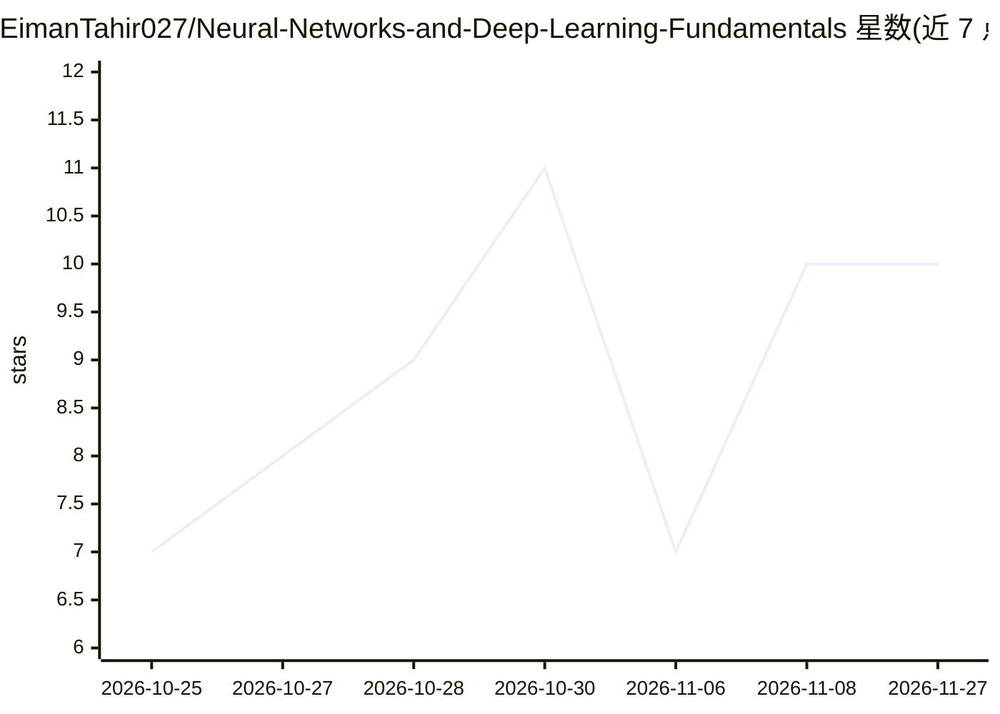

# EimanTahir027/Neural-Networks-and-Deep-Learning-Fundamentals

⭐ 10 · Python · MIT · 推送 2026-09-29 · [GitHub](https://github.com/EimanTahir027/Neural-Networks-and-Deep-Learning-Fundamentals) · 个人维护

**七天学习路径：神经网络与深度学习入门教程（含 CIFAR-10 项目）**

面向深度学习初学者的结构化教学仓库，按七天渐进路径组织：从神经元与前向传播、激活函数、损失函数与反向传播、梯度下降与优化器，到分别用 TensorFlow/Keras 和 PyTorch 构建网络，最终完成 CIFAR-10 图像分类端到端项目。内容以 Jupyter Notebook 形式提供，强调可复现实验、数据划分与指标跟踪等工程实践，并给出模型评估维度清单。README 仅含先修知识说明与克隆、虚拟环境、pip 安装依赖、启动 Notebook 的运行步骤。

## 筛选速览

| 维度 | 判定 | 备注 |
|---|---|---|
| AI 角色 | `ai-knowledge` | 知识聚合/清单类 |
| 许可风险 | `permissive` | MIT |
| 部署形态 | `library` | 以包/库形式分发 |
| 模型依赖 | — | README 未给出锁定关系 |
| 硬件要求 | — | 无带数字的原话,不猜 |
| 安装摩擦 | `low` | 无编译、无系统依赖或容器化 |
| 成熟度 | — | 结构信号不足 |

## 能力要点

- 七日渐进学习路径，覆盖前向传播、反向传播、优化算法到图像分类项目
- 同一主题分别提供 TensorFlow/Keras 与 PyTorch 两种实现路径
- 附带可复现实验、数据泄漏规避等生产向 ML 工程实践清单
- 模型评估章节列出准确率之外的 precision/recall/F1/混淆矩阵等维度

## 适用场景

- 系统学习神经网络与深度学习基础概念
- 对照学习 TensorFlow/Keras 与 PyTorch 的建模方式
- 完成一个 CIFAR-10 图像分类的入门练手项目

## 场景标签

`教程课程` · 领域:学习与行业

## 证据(README 行号)

> L9: A practical and structured introduction to neural networks and deep learning, covering the fundamentals required to 
> L11: This repository combines conceptual learning with hands-on implementation using TensorFlow, Keras, and PyTorch. The
> L166: ```text

## 星数曲线



2026-10-25 7 → 2026-11-27 10（+3）


---
*卡片 v1 · prompt 1.4 · 生成 2026-11-20 · 置信度 high · 依据 README sha `160287379353` · [字段定义](../../DATASET.md)*
