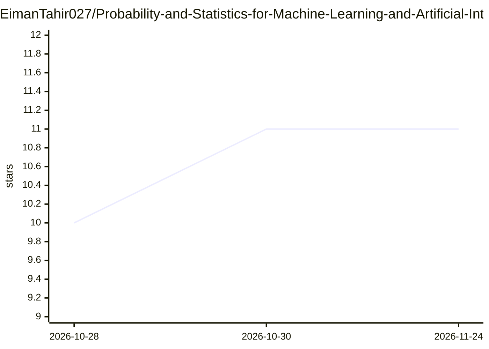

# EimanTahir027/Probability-and-Statistics-for-Machine-Learning-and-Artificial-Intelligence

⭐ 11 · Python · MIT · 推送 2026-08-09 · [GitHub](https://github.com/EimanTahir027/Probability-and-Statistics-for-Machine-Learning-and-Artificial-Intelligence) · 个人维护

**面向 ML/AI 学习者的概率与统计数学基础教程库**

按主题组织的概率论与统计推断学习参考资料，覆盖概率公理、常见分布、极大似然与贝叶斯估计、假设检验、描述统计，以及概率图模型、朴素贝叶斯、EM 算法、蒙特卡洛等在 ML/AI 中的应用。内容包含概念讲解、推导示例与部分代码演示，需克隆仓库浏览，代码示例依赖 numpy/scipy/matplotlib/pandas。仓库结构显示主题文件夹与 notebook 尚未上传（coming soon）。面向学生、从业者和研究者。

## 筛选速览

| 维度 | 判定 | 备注 |
|---|---|---|
| AI 角色 | `ai-knowledge` | 知识聚合/清单类 |
| 许可风险 | `permissive` | MIT |
| 部署形态 | `library` | 以包/库形式分发 |
| 模型依赖 | — | README 未给出锁定关系 |
| 硬件要求 | — | 无带数字的原话,不猜 |
| 安装摩擦 | `low` | 无编译、无系统依赖或容器化 |
| 成熟度 | — | 结构信号不足 |

## 能力要点

- 覆盖概率论、常见分布、统计推断、描述统计四大主题板块
- 含 ML/AI 应用专题：概率图模型、朴素贝叶斯、EM、蒙特卡洛、信息论
- 提供概念讲解、推导与代码演示，Python 3 运行示例
- 仅需高中数学与线性代数即可入门

## 适用场景

- 进阶 ML/AI 前系统补习概率与统计基础
- 查阅贝叶斯推断、MLE/MAP 等概念的推导示例
- 按主题文件夹检索特定统计概念的应用说明

## 场景标签

`教程课程` · 领域:学习与行业

## 证据(README 行号)

> L7: A curated learning resource covering the essential foundations of **Probability** and **Statistics** as they apply t
> L17: This repository provides:
> L100: > 📌 Content and notebooks will be added progressively. Watch or star the repository to stay updated!

## 星数曲线

2026-10-28 10 → 2026-11-24 11（+1）

---
*卡片 v1 · prompt 1.4 · 生成 2026-11-19 · 置信度 mid · 依据 README sha `f68123849eb2` · [字段定义](../../DATASET.md)*
