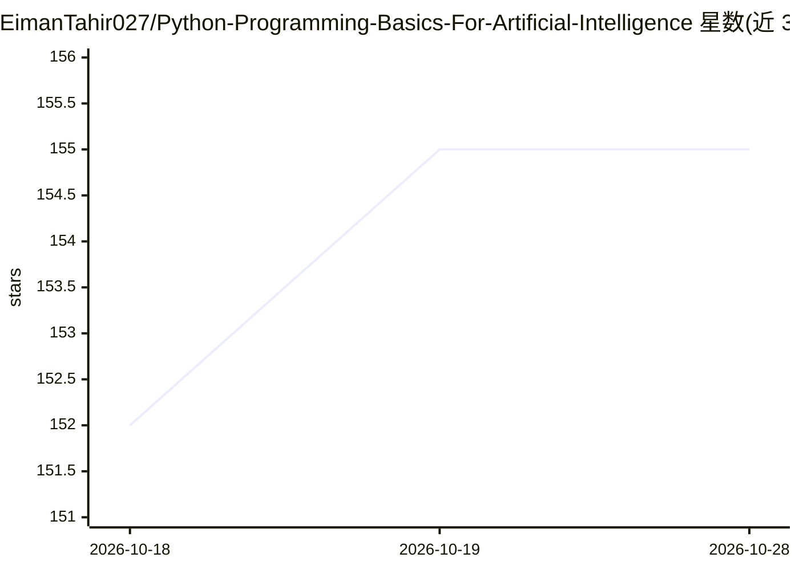

# EimanTahir027/Python-Programming-Basics-For-Artificial-Intelligence

⭐ 155 · Python · MIT · 推送 2026-08-08 · [GitHub](https://github.com/EimanTahir027/Python-Programming-Basics-For-Artificial-Intelligence) · [官网](https://eimantahir027.github.io/Python-Programming-Basics-For-Artificial-Intelligence/) · 个人维护

**面向 AI 方向初学者的 Python 编程结构化学习课程仓库**

由个人维护的 Python 学习工作区：以 8 个模块组织内容，覆盖 Python 基础语法、控制流、数据结构、函数、面向对象、文件处理，以及 NumPy/Pandas/Matplotlib/Scikit-learn 四个 AI 常用库和机器学习入门概念；附 9 个分级练习项目（计算器、成绩预测、图像分类、聊天机器人等）。安装方式为克隆仓库、创建虚拟环境并 pip 安装依赖库，要求 Python 3.8+，无需编程基础。

## 筛选速览

| 维度 | 判定 | 备注 |
|---|---|---|
| AI 角色 | `ai-knowledge` | 知识聚合/清单类 |
| 许可风险 | `permissive` | MIT |
| 部署形态 | `library` | 以包/库形式分发 |
| 模型依赖 | — | README 未给出锁定关系 |
| 硬件要求 | — | 无带数字的原话,不猜 |
| 安装摩擦 | `low` | 无编译、无系统依赖或容器化 |
| 成熟度 | — | 结构信号不足 |

## 能力要点

- 8 个模块从 Python 基础到机器学习概念的学习路径
- 9 个初级到高级的练习项目（含线性回归、图像分类、聊天机器人）
- 涉及 NumPy/Pandas/Matplotlib/Scikit-learn 四个库的用法章节

## 适用场景

- 零基础按模块顺序自学 Python 并转向 AI/ML
- 通过分级项目练习巩固编程与机器学习基础
- 查找 Python 学习的书单与在线平台资源

## 场景标签

`教程课程` · 领域:学习与行业

## 证据(README 行号)

> L13: This repository provides a structured learning path for beginners who want to master Python programming with the go
> L69: ### Module 8: Introduction to AI Concepts

## 星数曲线

2026-10-18 152 → 2026-10-28 155（+3）

---
*卡片 v1 · prompt 1.4 · 生成 2026-10-22 · 置信度 mid · 依据 README sha `c33493eb3e85` · [字段定义](../../DATASET.md)*
