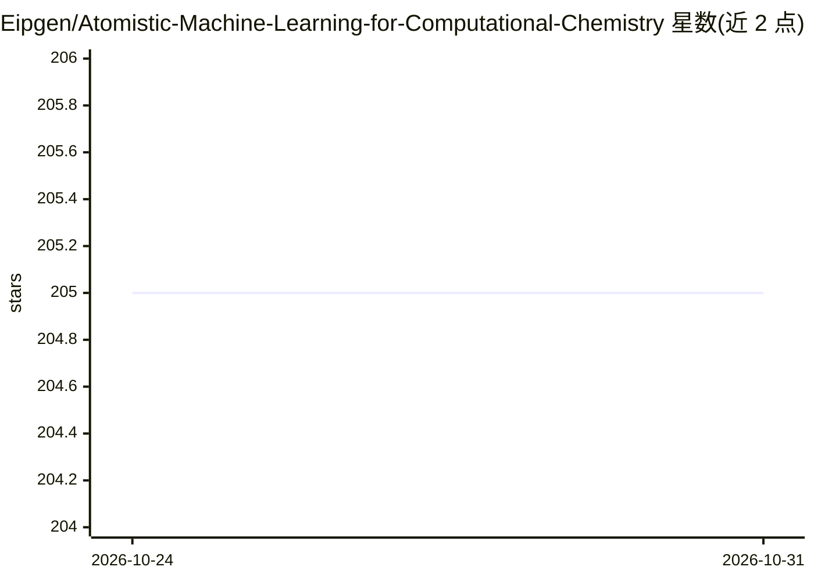

# Eipgen/Atomistic-Machine-Learning-for-Computational-Chemistry

⭐ 205 · MIT · 推送 2026-10-23 · [GitHub](https://github.com/Eipgen/Atomistic-Machine-Learning-for-Computational-Chemistry) · 个人维护

**计算化学原子级机器学习模型策展清单**

面向计算化学研究者的原子级机器学习模型与方法策展清单：按量子化学方法（含量子蒙特卡洛、格林函数）与力场方法（核方法、图模型等）分类，条目以“模型-项目/论文链接-描述”组织，说明模型的主要表示、目标与用途。覆盖神经网络泛函、波函数模型、 equivariant 势、电荷密度预测等方向，并设近期新增条目栏。清单仅收录链接与描述，不提供代码或安装方式。

## 筛选速览

| 维度 | 判定 | 备注 |
|---|---|---|
| AI 角色 | `ai-knowledge` | 知识聚合/清单类 |
| 许可风险 | `permissive` | MIT |
| 部署形态 | `None` |  |
| 模型依赖 | — | README 未给出锁定关系 |
| 硬件要求 | — | 无带数字的原话,不猜 |
| 安装摩擦 | `low` | 无编译、无系统依赖或容器化 |
| 成熟度 | — | 结构信号不足 |

## 能力要点

- 按量子化学/力场/核方法等类别组织模型条目
- 条目含模型-链接-描述三要素
- 跟踪新近模型（UMA、Orb-V3、MatterSim、MACE 等）

## 适用场景

- 查找特定化学任务的机器学习模型实现
- 了解机器学习密度泛函与神经势的模型全景

## 场景标签

`精选清单` · 领域:学习与行业

## 证据(README 行号)

> L4: A curated collection of atomistic machine-learning models and methods for computational chemistry.
> L7: This list covers neural-network and machine-learning models used in quantum chemistry, atomistic force fields, semi-

## 星数曲线

2026-10-24 205 → 2026-10-31 205（+0）

---
*卡片 v1 · prompt 1.4 · 生成 2026-10-23 · 置信度 high · 依据 README sha `8f1ccb1d87d7` · [字段定义](../../DATASET.md)*
