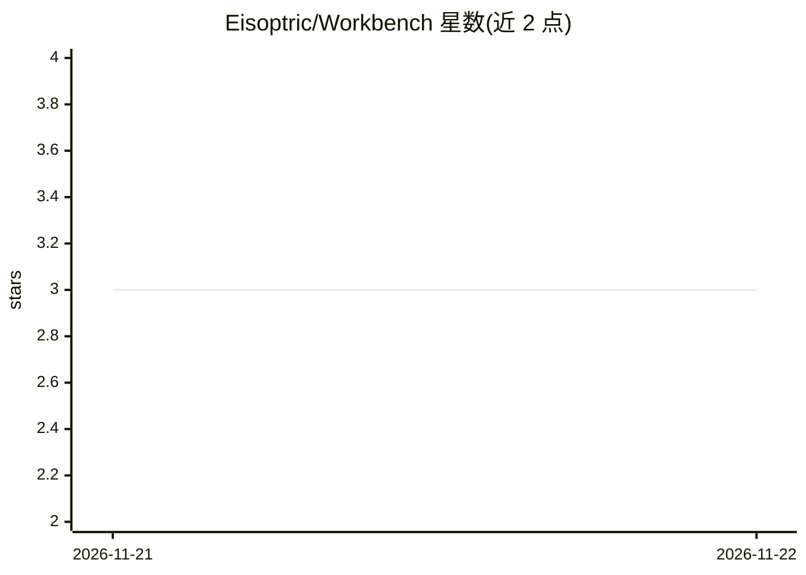

# Eisoptric/Workbench

⭐ — · [GitHub]() · 个人维护 · 中文 README

**本地优先的 AI 研究工作台：实验、样本与发现以纯文件管理**

基于 Rust/Tauri 的桌面研究工作台，将问题、假设、冻结实验版本、运行、样本与发现保存为项目 `.workbench/research` 下的纯文本文件，可 diff 与提交。核心机制包括实验冻结版本与只读快照、OS 级沙箱（macOS seatbelt / Linux bubblewrap）、评分对比图仅纳入可比运行、激活值查看与稀疏自编码器检查。研究助手以十四个 `research_*` 工具与 68 个内置技能运作，可在 API 模型、Claude Code、Codex 或本地模型上运行，仅监听 127.0.0.1，无后端服务器。支持本地或 SSH 主机运行。

## 筛选速览

| 维度 | 判定 | 备注 |
|---|---|---|
| AI 角色 | `ai-enhanced` | 去掉 AI 部分产品仍成立 |
| 许可风险 | `permissive` | — |
| 部署形态 | `desktop` | 安装包/桌面程序 |
| 模型依赖 | local-ok | 支持本地模型 |
| 硬件要求 | — | 无带数字的原话,不猜 |
| 安装摩擦 | `low` | 无编译、无系统依赖或容器化 |
| 成熟度 | — | 结构信号不足 |

## 能力要点

- 实验冻结为版本，冻结版本的数据与评分文件对 agent 锁定
- 运行在系统沙箱中执行，全部外发 HTTP 请求记录于可读网络日志
- 跨模型逐样本对比、激活值查看、activation patching 与稀疏自编码器特征
- 助手提供 Ask/Approve/Auto/Agent 四种权限模式与 git worktree 任务

## 适用场景

- 做可解释性研究时逐样本阅读模型输出并保留反例
- 管理 Pythia 等模型多 checkpoint 的评测与微调实验
- 让 agent 在受限模式下协助写假设、跑评测并做泄漏审计
- 在 SSH 主机上远程运行实验并跟踪资源占用

## 场景标签

`模型评测` `MLOps` · 领域:评测与运维

## 证据(README 行号)

> L5: **A workbench for AI research, on your own computer.**
> L27: - **Your research, not a chat.** Questions, hypotheses, experiments, versions, runs, samples, labels and findings e
> L99: **On any backend.** The assistant runs on an API model, on Claude Code with your Claude plan, on Codex with your Ch

## 星数曲线

2026-11-21 3 → 2026-11-22 3（+0）

---
*卡片 v1 · prompt 1.4 · 生成 2026-11-22 · 置信度 low · 依据 README sha `548548bd0309` · [字段定义](../../DATASET.md)*
