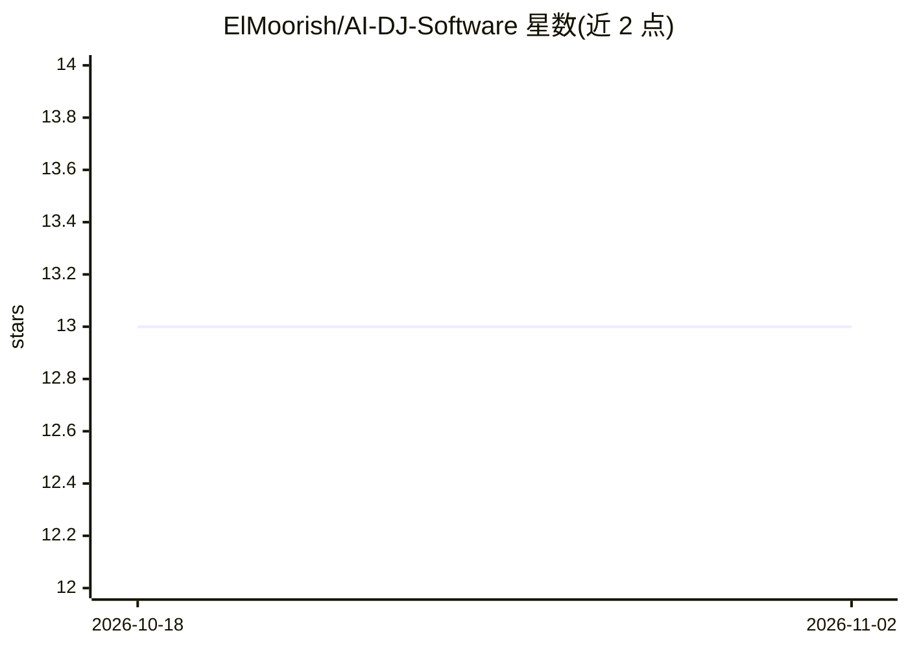

# ElMoorish/AI-DJ-Software

⭐ 13 · TypeScript · Apache-2.0 · 推送 2026-03-13 · [GitHub](https://github.com/ElMoorish/AI-DJ-Software) · [官网](https://www.moorish.dev) · 个人维护

**本地离线运行的 AI 桌面 DJ 应用：自动混音与子流派分类**

基于 Electron/React 的开源桌面 DJ 应用，AI 推理全部本地完成：用 Audio Spectrogram Transformer 做层级子流派分类（巴西 Funk、Phonk、House/Techno 共 14+ 细类），CLAP 512 维嵌入支持文本语义音频搜索，前瞻树搜索结合 Camelot 调性和 BPM 生成混音序列，FFmpeg 渲染带 EQ/回声转场的无缝 MP3。需手动从 Hugging Face 下载 ONNX 模型，附自有抓取与训练脚本。

## 筛选速览

| 维度 | 判定 | 备注 |
|---|---|---|
| AI 角色 | `ai-native` | 本体是模型或模型工具 |
| 许可风险 | `permissive` | Apache-2.0 |
| 部署形态 | `library` | 以包/库形式分发 |
| 模型依赖 | — | README 未给出锁定关系 |
| 硬件要求 | — | 无带数字的原话,不猜 |
| 安装摩擦 | `medium` | 含编译或系统依赖之一 |
| 成熟度 | — | 结构信号不足 |

## 能力要点

- AST 宏观模型路由到多个自定义子流派专用模型
- CLAP 嵌入的文本语义音频搜索
- Camelot 调性+BPM+能量弧的混音序列前瞻树搜索
- 全部音频分析与推理本地离线运行

## 适用场景

- 让 DJ 应用自动按和声与 BPM 生成连续混音
- 对本地音乐库做细粒度子流派分类
- 用文字描述搜索本地曲库（如 dark driving bass）

## 场景标签

`语义搜索` · 领域:知识与检索

## 证据(README 行号)

> L13: **AI DJ** brings sophisticated machine learning to automated playlist generation and micro-genre classification. Un
> L32: ### 🧠 Hierarchical Genre Classification (AST)
> L47: ### 🔍 Semantic Audio Search

## 星数曲线

2026-10-18 13 → 2026-11-02 13（+0）

---
*卡片 v1 · prompt 1.4 · 生成 2026-10-31 · 置信度 high · 依据 README sha `06ea2ddf6da8` · [字段定义](../../DATASET.md)*
