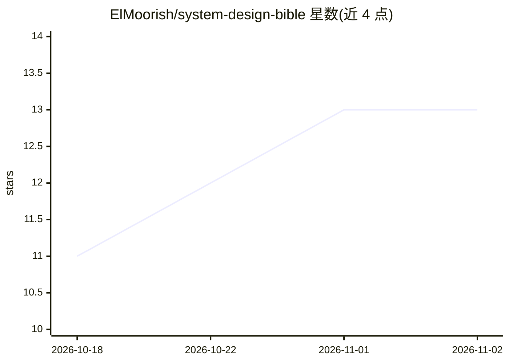

# ElMoorish/system-design-bible

⭐ 13 · MIT · 推送 2026-03-17 · [GitHub](https://github.com/ElMoorish/system-design-bible) · 个人维护

**面向 AI 时代的系统设计参考手册：经典模式加 LLM/RAG/Agent 新内容**

免费开源的系统设计参考手册，定位为对经典 System Design Primer 的更新与扩展：在可扩展性、数据库、缓存、分布式系统等基础章节之上，新增 LLM 基础设施（GPU 内存、KV cache、vLLM）、RAG 系统、Agent 架构、向量数据库、LLMOps 等 AI 时代章节，并附 12 个公司架构案例、50 道带解答的面试题与术语表。面向 2 年以上经验、准备 L4–Staff 级系统设计面试或构建 LLM 生产系统的工程师；声明不面向初学者、ML 研究者或代码教程需求者。内容以原创讲解与图表为主，按月更新。

## 筛选速览

| 维度 | 判定 | 备注 |
|---|---|---|
| AI 角色 | `ai-knowledge` | 知识聚合/清单类 |
| 许可风险 | `permissive` | MIT |
| 部署形态 | `None` |  |
| 模型依赖 | — | README 未给出锁定关系 |
| 硬件要求 | — | 无带数字的原话,不猜 |
| 安装摩擦 | `low` | 无编译、无系统依赖或容器化 |
| 成熟度 | — | 结构信号不足 |

## 能力要点

- 覆盖 LLM 基础设施、RAG、Agent、向量数据库、LLMOps 等 AI 时代章节
- 12 个真实公司架构案例与 50 道带解答的系统设计面试题
- 相对 Primer 更新了延迟数据（2026 NVMe/GPU）与 NewSQL/向量库内容
- 80+ 条术语定义的 Glossary

## 适用场景

- 准备 L4–Staff 级系统设计面试
- 构建 LLM/RAG/Agent 生产系统时查阅架构模式
- 系统学习从经典分布式系统到 AI 基础设施的演进

## 场景标签

`教程课程` · 领域:学习与行业

## 证据(README 行号)

> L7: - **Beyond the Primer**: We add the AI infrastructure patterns that reached production after 2022.
> L12: This repository is for software engineers with 2+ years of experience who are preparing for system design interview

## 星数曲线

2026-10-18 11 → 2026-11-02 13（+2）

---
*卡片 v1 · prompt 1.4 · 生成 2026-10-31 · 置信度 high · 依据 README sha `281543b0fbaa` · [字段定义](../../DATASET.md)*
