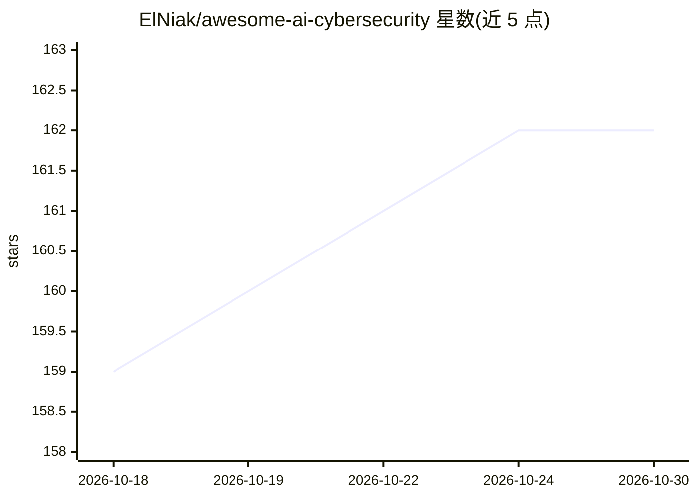

# ElNiak/awesome-ai-cybersecurity

⭐ 162 · CC0-1.0 · 推送 2026-10-29 · [GitHub](https://github.com/ElNiak/awesome-ai-cybersecurity) · 个人维护

**AI 网络安全资源清单：按 PPDR 模型与技术层分类的工具与论文合集**

面向安全专业人员、研究者与爱好者的 awesome 类资源清单：按 Gartner PPDR 模型（预测/防护/检测/响应/监控）和网络、端点、应用、用户、过程行为等技术层，收录渗透测试、恶意软件分析、入侵检测、用户行为分析、欺诈检测等方向的开源工具、教程、认证与研究论文；另含 AI SaaS 安全最佳实践与 LLM 漏洞扫描工具条目。清单本身不提供可运行软件。

## 筛选速览

| 维度 | 判定 | 备注 |
|---|---|---|
| AI 角色 | `ai-knowledge` | 知识聚合/清单类 |
| 许可风险 | `viral` | CC0-1.0 |
| 部署形态 | `None` |  |
| 模型依赖 | — | README 未给出锁定关系 |
| 硬件要求 | — | 无带数字的原话,不猜 |
| 安装摩擦 | `low` | 无编译、无系统依赖或容器化 |
| 成熟度 | — | 结构信号不足 |

## 能力要点

- 按 Gartner PPDR 模型与技术层两级分类组织条目
- 覆盖工具、教程、认证、研究论文与书籍多种资源类型
- 包含 LLM 安全方向条目（garak、promptfoo、CVE-LMTune 等）

## 适用场景

- 查找网络安全各环节可用的 AI/ML 工具与项目
- 按技术层检索入侵检测、恶意软件分析等方向的论文
- 了解 AI SaaS 安全最佳实践与 LLM 漏洞扫描工具

## 场景标签

`精选清单` `网络安全` · 领域:学习与行业

## 证据(README 行号)

> L7: Welcome to the ultimate list of resources for AI in cybersecurity.
> L14: AI applications in cybersecurity can be categorized using Gartner's PPDR model:

## 星数曲线

2026-10-18 159 → 2026-10-30 162（+3）

---
*卡片 v1 · prompt 1.4 · 生成 2026-10-22 · 置信度 high · 依据 README sha `9eb43ecee2fd` · [字段定义](../../DATASET.md)*
