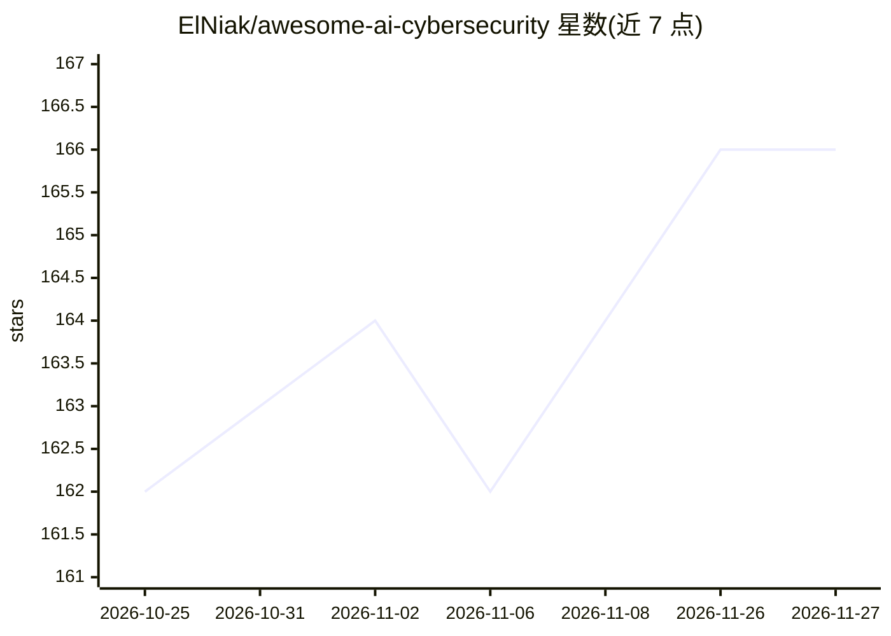

# ElNiak/awesome-ai-cybersecurity

⭐ 166 · CC0-1.0 · 推送 2026-10-29 · [GitHub](https://github.com/ElNiak/awesome-ai-cybersecurity) · 个人维护

**网络安全领域 AI 资源清单：为从业者与研究者组织学习与研究素材**

按 Gartner PPDR 模型（预测/预防/检测/响应/监控）与技术层（网络/终端/应用/用户/流程行为）组织的 AI+网络安全资源聚合清单。条目分为三类：可用于渗透测试各阶段的工具（含 AI 增强的 IDS、漏洞扫描、恶意软件分析）、 securing AI SaaS 的实践框架与工具、按 ML 技术（回归/分类/聚类）组织的综述论文与书籍。本身不提供可运行软件，仅收录与注释外部资源。

## 筛选速览

| 维度 | 判定 | 备注 |
|---|---|---|
| AI 角色 | `ai-knowledge` | 知识聚合/清单类 |
| 许可风险 | `viral` | CC0-1.0 |
| 部署形态 | `None` |  |
| 模型依赖 | — | README 未给出锁定关系 |
| 硬件要求 | — | 无带数字的原话,不猜 |
| 安装摩擦 | `low` | 无编译、无系统依赖或容器化 |
| 成熟度 | — | 结构信号不足 |

## 能力要点

- 按 PPDR 五阶段与技术层双层维度组织条目
- 覆盖渗透测试、恶意软件分析、IDS/IPS、威胁情报等子领域
- 收录 LLM 安全工具（garak、promptfoo、PentestGPT）
- 附综述论文、教程与认证资源

## 适用场景

- 为安全团队调研 AI 检测与响应工具
- 研究者查找入侵检测/恶意软件分类的综述文献
- 了解 LLM 安全测试与红队工具生态

## 场景标签

`精选清单` `网络安全` `科研工具` · 领域:学习与行业

## 证据(README 行号)

> L5: # Awesome AI in Cybersecurity
> L8: This repository aims to provide an organized collection of high-quality resources to help professionals, researchers
> L10: ## Contents

## 星数曲线

2026-10-25 162 → 2026-11-27 166（+4）

---
*卡片 v1 · prompt 1.4 · 生成 2026-11-27 · 置信度 high · 依据 README sha `7e0cdfdc2813` · [字段定义](../../DATASET.md)*
