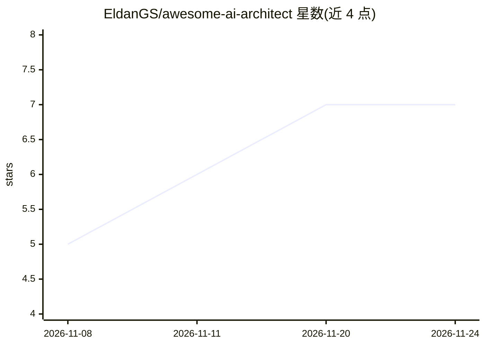

# EldanGS/awesome-ai-architect

⭐ 7 · Python · CC0-1.0 · 推送 2026-11-06 · [GitHub](https://github.com/EldanGS/awesome-ai-architect) · 个人维护

**面向 AI 解决方案架构师的课程、架构模式与认证清单**

## 筛选速览

| 维度 | 判定 | 备注 |
|---|---|---|
| AI 角色 | `ai-knowledge` | 知识聚合/清单类 |
| 许可风险 | `viral` | CC0-1.0 |
| 部署形态 | `None` |  |
| 模型依赖 | — | README 未给出锁定关系 |
| 硬件要求 | — | 无带数字的原话,不猜 |
| 安装摩擦 | `low` | 无编译、无系统依赖或容器化 |
| 成熟度 | — | 结构信号不足 |

## 能力要点

- 自带免费认证备考课程：8 个领域、实验、复习题与 60 题模拟考
- 免费认证追踪表收录 230+ 门带证书/徽章的免费 AI 课程
- 整理 RAG、Agent、LLMOps、治理等架构模式与生产实践指南
- 收录 AWS 与 Azure 的云参考架构与落地实现清单

## 适用场景

- 备考 AI Solution Architect 认证时按路径查找课程
- 为企业 AI 系统设计查找云参考架构与安全治理资料
- 收集带免费证书的官方 AI 学习资源

## 场景标签

`精选清单` `教程课程` · 领域:学习与行业

## 证据(README 行号)

> L3: > A curated list of courses, reference architectures, repositories, frameworks and certifications to prepare for the
> L9: - AI Solution Architect Certification Prep Course - 8 weighted domains, labs, review questions, a 60-question mock e
> L106: ## Architecture Patterns and Guides

## 星数曲线

2026-11-08 5 → 2026-11-24 7（+2）

---
*卡片 v1 · prompt 1.4 · 生成 2026-11-20 · 置信度 high · 依据 README sha `894983eddd05` · [字段定义](../../DATASET.md)*
