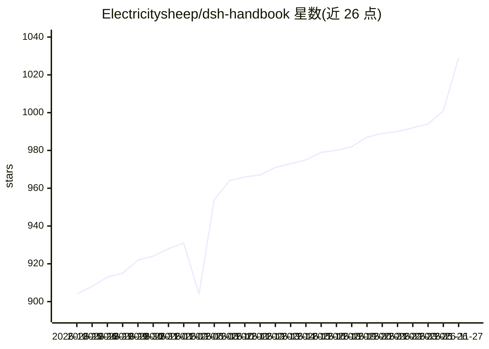

# Electricitysheep/dsh-handbook

⭐ 1,029 · HTML · 推送 2026-11-04 · [GitHub](https://github.com/Electricitysheep/dsh-handbook) · [官网](https://github.com/Electricitysheep/dsh-handbook) · 个人维护 · 中文 README

**给开发者的 DeepSeek Harness(dsh) 从零上手中文手册**

围绕 DeepSeek 官方开源的 Agent 运行时 dsh 编写的教程手册：15 章 + 附录，覆盖从认知、安装运行（web/headless 双模式）、profile 与插件开发实战，到推理档位调优、缓存成本分析、安全沙箱与生态全景报告；并提供 3 天学习路径、可克隆插件模板、一页速查卡、5 个实测案例与同模型多 Agent 对比 benchmark，中英文 PDF 供下载。内容基于 0.1.0-rc.6 版本实测，README 明示后续版本存在破坏性变更，需以官方文档为准。

## 筛选速览

| 维度 | 判定 | 备注 |
|---|---|---|
| AI 角色 | `ai-knowledge` | 知识聚合/清单类 |
| 许可风险 | `none` | — |
| 部署形态 | `library` | 以包/库形式分发 |
| 模型依赖 | — | README 未给出锁定关系 |
| 硬件要求 | — | 无带数字的原话,不猜 |
| 安装摩擦 | `low` | 无编译、无系统依赖或容器化 |
| 成熟度 | — | 结构信号不足 |

## 能力要点

- 15 章从 0 到 1 学习路径（3 天计划，含每日目标与验收标准）
- 插件开发实战：可克隆模板 + 3 个真实开源 PR 拆解 + 实机验证
- 1804 个插件仓库 × 780 帧讨论区的生态全景报告（第 15 章）
- 同模型三 Agent 实测 benchmark（5 任务 × 3 轮中位数）

## 适用场景

- 我想第一次接触 dsh，跟着教程从安装到写插件
- 我在多个 Agent 框架之间选型，需要对比数据
- 我要调优 dsh 的推理档位和缓存成本
- 我想了解 dsh 插件生态有哪些社区项目

## 场景标签

`教程课程` · 领域:学习与行业

## 证据(README 行号)

> L45: 但官方文档以架构说明为主，**缺少一条从零上手的路径**。
> L47: **这本白皮书补上这条路**：从"什么是 Agent 运行时"讲起，到安装、使用、开发插件、性能调优——每一章都有可复制、可运行的命令，全部在本机实测验证。**目标是：任何一个开发者，跟着这本书都能从 0 到 1 用起来、写起来。
> L20: > **正文实测基线是 `0.1.0-rc.6`（版本线同步到 `v0.1.3-alpha.1`），当前 DSH 已是 `v0.2.2-alpha.3`。** 自该基线以来有破坏性变更：Node `>=24.9`（0.2.2 起）

## 星数曲线

2026-10-25 904 → 2026-11-27 1,029（+125）

---
*卡片 v1 · prompt 1.4 · 生成 2026-11-24 · 置信度 mid · 依据 README sha `da01155f2a9f` · [字段定义](../../DATASET.md)*
