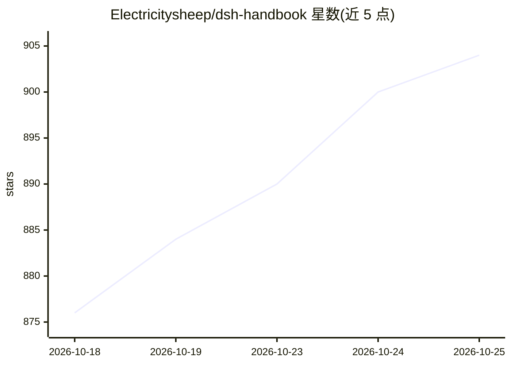

# Electricitysheep/dsh-handbook

⭐ 904 · HTML · 推送 2026-10-04 · [GitHub](https://github.com/Electricitysheep/dsh-handbook) · [官网](https://github.com/Electricitysheep/dsh-handbook) · 个人维护 · 中文 README

**DeepSeek Harness (dsh) 从 0 到 1 中文深度手册与生态观察**

面向 dsh（DeepSeek 官方开源的 Agent 运行时，'一切皆插件'框架）的 15 章中文手册，英文 PDF 同步提供。覆盖安装、web/headless 双模式、插件开发实战、性能调优（推理档位/缓存命中率实测）、5 个实战案例，以及基于 1804 个插件仓库与 780 帖讨论区交叉验证的生态全景报告，附同模型多 Agent 实测 benchmark 与 FAQ。读者对象为初次接触 dsh 的开发者、插件开发者和选型评估者；正文实测基于 rc 版本，手册自述版本迭代可能导致章节命令失效。

## 筛选速览

| 维度 | 判定 | 备注 |
|---|---|---|
| AI 角色 | `ai-knowledge` | 知识聚合/清单类 |
| 许可风险 | `none` | — |
| 部署形态 | `library` | 以包/库形式分发 |
| 模型依赖 | locked-api |  |
| 硬件要求 | — | 无带数字的原话,不猜 |
| 安装摩擦 | `low` | 无编译、无系统依赖或容器化 |
| 成熟度 | `idea` | |

## 能力要点

- 15 章手册覆盖安装、插件开发、性能调优与生态全景
- 1804 插件仓库 × 780 帖讨论区交叉验证的生态观察
- 同模型（deepseek-v4-flash）下 dsh/omp/opencode 三 Agent 实测对比
- 每章含可复制命令，附中文/英文 PDF 与一页速查卡

## 适用场景

- 第一次接触 dsh，按 3 天学习路径从 0 到 1 上手
- 跟着完整代码示例开发第一个 dsh 插件
- 对比 dsh 与 Claude Code/Codex 等 Agent 做选型评估
- 了解 dsh 插件生态现状与安全/成本工程实践

## 场景标签

`教程课程` · 领域:学习与行业

## 证据(README 行号)

> L3: > **DeepSeek Harness 中文手册 × 生态观察中心**——从 0 到 1 玩转 dsh，跟着 780 帖讨论区看懂生态 · 中文 · English
> L47: **这本白皮书补上这条路**：从"什么是 Agent 运行时"讲起，到安装、使用、开发插件、性能调优——每一章都有可复制、可运行的命令，全部在本机实测验证。**目标是：任何一个开发者，跟着这本书都能从 0 到 1 用起来、写起来。

## 星数曲线

2026-10-18 876 → 2026-10-25 904（+28）

---
*卡片 v1 · prompt 1.4 · 生成 2026-10-21 · 置信度 mid · 依据 README sha `5c16c5bb7def` · [字段定义](../../DATASET.md)*
