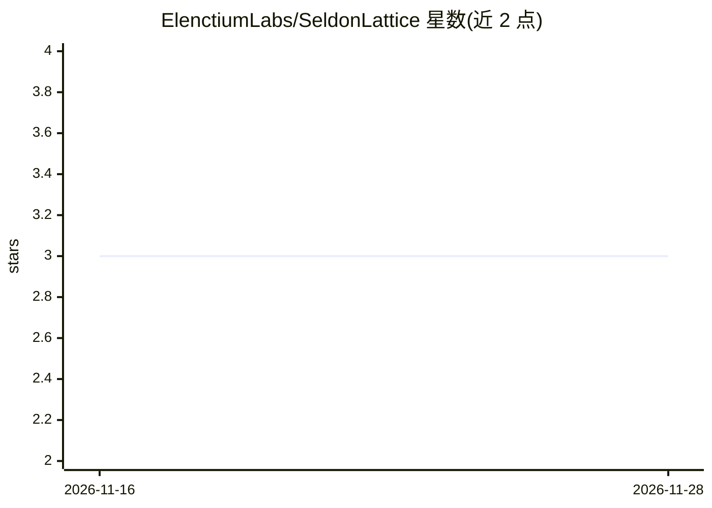

# ElenctiumLabs/SeldonLattice

⭐ 3 · C# · MIT · 推送 2026-11-24 · [GitHub](https://github.com/ElenctiumLabs/SeldonLattice) · 个人维护

**双 agent 辩证推理引擎，本地运行并流式呈现思维导图**

一个研究性质的辩证推理引擎：两个角色化 agent（proposer/skeptic）围绕问题辩论，mediator 桥接立场，moderator 综合上升为更高层问题，gate 决定是否继续攀升。每轮内容写入内容寻址、ML-DSA 签名的 Merkle 存储。后端为 ASP.NET Core API，前端为 React + TypeScript 思维导图客户端，通过 SSE 实时流式展示辩论。推理依赖本地 llama.cpp（聊天与嵌入模型）或任意 OpenAI 兼容端点；模型 GGUF 文件需另行下载。自称 research project、local-first 工具。

## 筛选速览

| 维度 | 判定 | 备注 |
|---|---|---|
| AI 角色 | `ai-native` | 本体是模型或模型工具 |
| 许可风险 | `permissive` | MIT |
| 部署形态 | `library` | 以包/库形式分发 |
| 模型依赖 | local-ok | 支持本地模型 |
| 硬件要求 | — | 无带数字的原话,不猜 |
| 安装摩擦 | `medium` | 含编译或系统依赖之一 |
| 成熟度 | `idea` | |

## 能力要点

- proposer/skeptic/mediator/gate 四角色的辩证上升流程
- 内容寻址、ML-DSA 签名的 Merkle 存储
- SSE 流式输出到 React 交互式思维导图
- 本地 llama.cpp 推理或 OpenAI 兼容端点

## 适用场景

- 让两个角色化 agent 就哲学问题进行多轮辩证辩论
- 在本地用自己的模型研究多 agent 辩论与综合机制
- 以思维导图形式追踪每轮辩论的节点与综合过程

## 场景标签

`多智能体` · 领域:Agent 开发

## 证据(README 行号)

> L7: A dialectical reasoning engine. Two role-based agents debate a question, mediators bridge
> L19: - Local llama.cpp inference for chat and embeddings, or any OpenAI-compatible endpoint.

## 星数曲线

2026-11-16 3 → 2026-11-28 3（+0）

---
*卡片 v1 · prompt 1.4 · 生成 2026-11-22 · 置信度 high · 依据 README sha `d9d5d2050545` · [字段定义](../../DATASET.md)*
