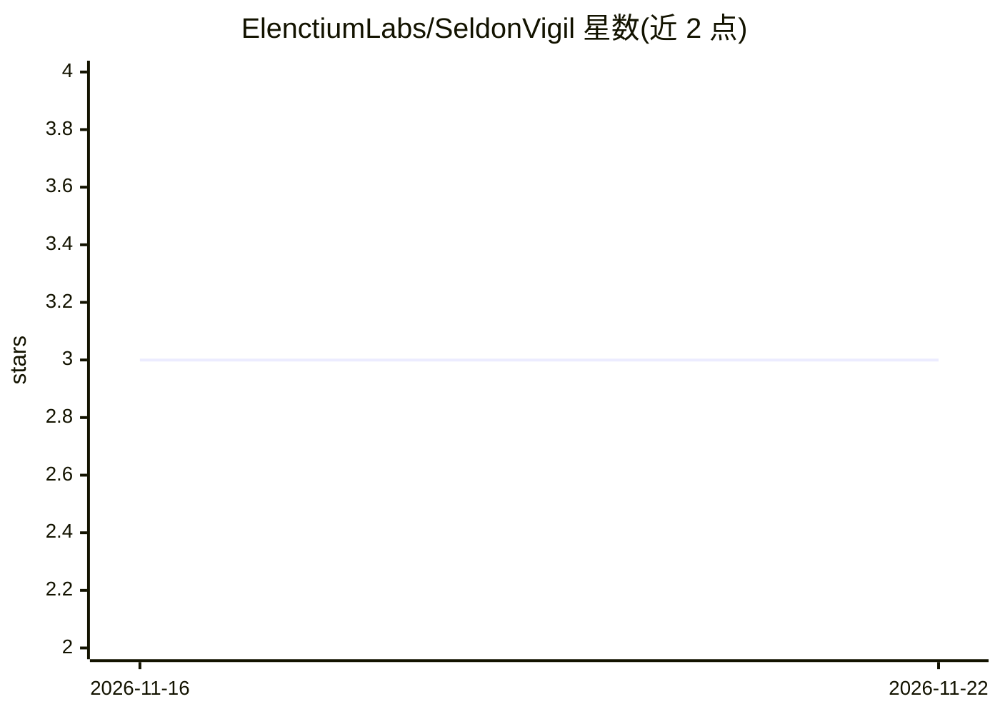

# ElenctiumLabs/SeldonVigil

⭐ 3 · C# · MIT · 推送 2026-11-19 · [GitHub](https://github.com/ElenctiumLabs/SeldonVigil) · 组织维护

**面向 AI Agent 系统的可观测、安全与治理平台**

以模块化单体架构构建的平台，包含 ASP.NET Core API、后台 Worker、客户端 SDK、CLI 与 Web UI 等模块。功能覆盖链路追踪/指标/日志、威胁检测、策略执行与合规、按模型和 Agent 拆分的成本分析、Agent 认证流水线与审批阶段，以及消息代理管理（topic、消费组、死信路由）。通过 Docker Compose 启动 Redpanda、Prometheus、API、Worker 与 Web UI，需本地运行 PostgreSQL 18+。

## 筛选速览

| 维度 | 判定 | 备注 |
|---|---|---|
| AI 角色 | `ai-ecosystem` | LLM/agent 周边工具 |
| 许可风险 | `permissive` | MIT |
| 部署形态 | `self-host` | docker 或自建部署 |
| 模型依赖 | — | README 未给出锁定关系 |
| 硬件要求 | — | 无带数字的原话,不猜 |
| 安装摩擦 | `low` | 无编译、无系统依赖或容器化 |
| 成熟度 | — | 结构信号不足 |

## 能力要点

- 跨 agents、tools 与 LLM 调用的层级执行链路追踪
- 按模型和 Agent 拆分的成本分析与预算对比
- Agent 认证流水线与审批阶段管理
- Redpanda topic 与消费组健康监控

## 适用场景

- 集中追踪多 Agent 系统的调用链路与 LLM 调用
- 监控 Agent 相关支出与预算执行情况
- 对 Agent 执行策略违规与合规进行审计
- 管理消息代理的 topic 与消费组

## 场景标签

`LLM 可观测性` `网络安全` · 领域:评测与运维

## 证据(README 行号)

> L8: **SeldonVigil** is an enterprise-grade observability, security, and governance platform for AI agent systems.
> L44: |Observability|Tracing, metrics, logging|
> L51: |Domain|Agent runtime: prompts, memory, tool orchestration, model routing|

## 星数曲线

2026-11-16 3 → 2026-11-22 3（+0）

---
*卡片 v1 · prompt 1.4 · 生成 2026-11-22 · 置信度 high · 依据 README sha `da45cfebcc4e` · [字段定义](../../DATASET.md)*
