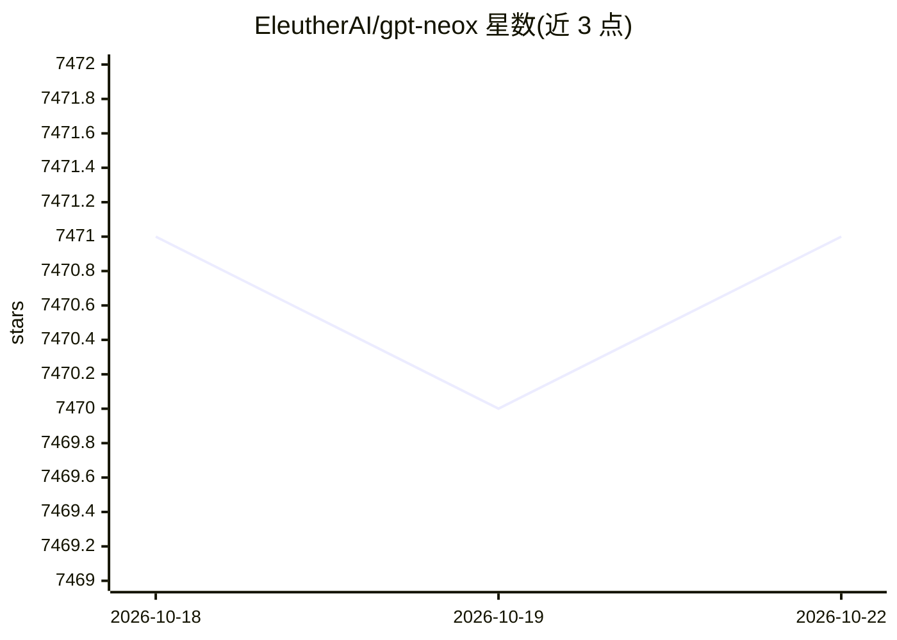

# EleutherAI/gpt-neox

⭐ 7,471 · Python · Apache-2.0 · 推送 2026-10-11 · [GitHub](https://github.com/EleutherAI/gpt-neox) · [官网](https://www.eleuther.ai/) · 组织维护

**GPU 上大规模自回归语言模型的分布式训练库**

EleutherAI 维护的大语言模型训练框架，基于 NVIDIA Megatron 并引入 DeepSpeed 技术，支持 ZeRO 与 3D 并行、rotary/alibi 位置编码、flash attention、课程学习，预置 Pythia/PaLM/Falcon/LLaMA 等架构配置。面向从零训练数十亿参数模型的研究与工程团队，40+ 组织曾用于训练 50+ 个模型；README 明确提示通用推理需求应改用 Hugging Face transformers。支持 Slurm/MPI/IBM JSM 多节点启动、NVIDIA 与 AMD GPU，提供 Docker/Apptainer 容器。

## 筛选速览

| 维度 | 判定 | 备注 |
|---|---|---|
| AI 角色 | `ai-ecosystem` | LLM/agent 周边工具 |
| 许可风险 | `permissive` | Apache-2.0 |
| 部署形态 | `self-host` | docker 或自建部署 |
| 模型依赖 | — | README 未给出锁定关系 |
| 硬件要求 | — | 无带数字的原话,不猜 |
| 安装摩擦 | `low` | 无编译、无系统依赖或容器化 |
| 成熟度 | — | 结构信号不足 |

## 能力要点

- ZeRO 与 3D 并行的分布式训练
- 预置 Pythia/PaLM/Falcon/LLaMA 架构配置
- Slurm/MPI/pdsh 多节点启动，兼容 NVIDIA 与 AMD GPU
- 提供 Docker 与 Apptainer 容器化运行方式

## 适用场景

- 在 GPU 集群上从零预训练数十亿参数语言模型
- 复现 Pythia 等已有训练套件的实验配置
- 在 Slurm/HPC 环境中编排多节点训练任务

## 场景标签

`模型训练` · 领域:训练与推理

## 证据(README 行号)

> L6: This repository records EleutherAI's library for training large-scale language models on GPUs. Our current framework
> L10: **If you are not looking to train models with billions of parameters from scratch, this is likely the wrong library

## 星数曲线

2026-10-18 7,471 → 2026-10-22 7,471（+0）

---
*卡片 v1 · prompt 1.4 · 生成 2026-10-20 · 置信度 high · 依据 README sha `34262c72613f` · [字段定义](../../DATASET.md)*
