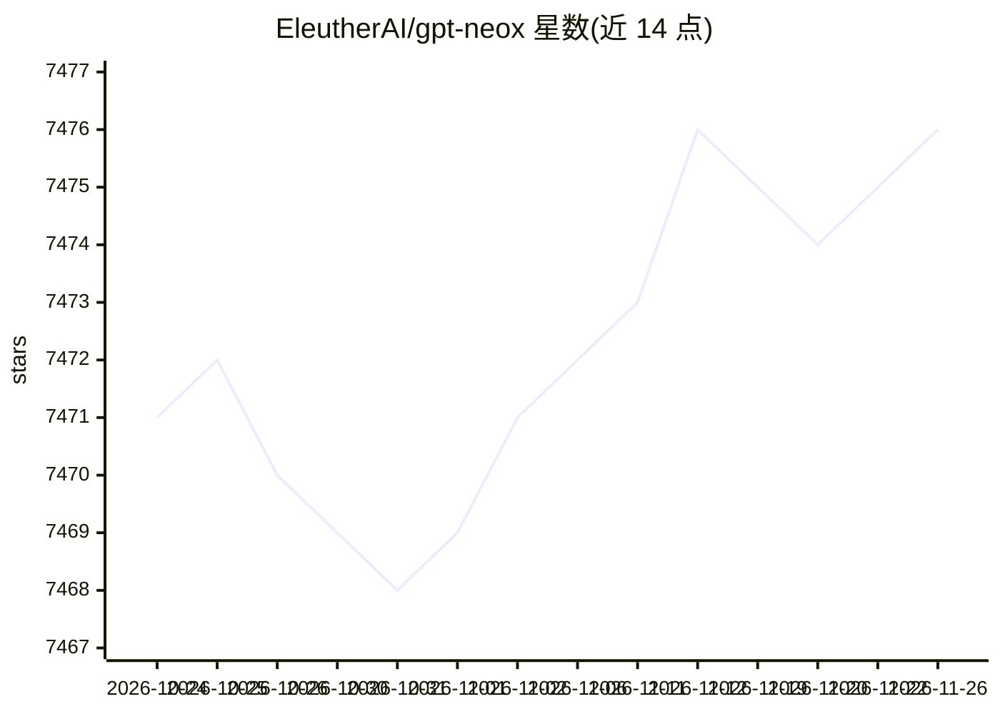

# EleutherAI/gpt-neox

⭐ 7,476 · Python · Apache-2.0 · 推送 2026-11-23 · [GitHub](https://github.com/EleutherAI/gpt-neox) · [官网](https://www.eleuther.ai/) · 组织维护

**基于 Megatron/DeepSpeed 的大规模自回归语言模型 GPU 训练库**

EleutherAI 用于在 GPU 上训练数十亿参数自回归语言模型的训练库，基于 NVIDIA Megatron 并融合 DeepSpeed 技术与自有优化。核心机制包括 ZeRO 与 3D 并行的分布式训练、rotary/alibi 位置编码与 flash attention、Pythia/PaLM/Falcon/LLaMA 预定义配置，以及 Slurm/MPI/pdsh 等多节点启动方式。已用于训练 Pythia、StableLM、RedPajama-INCITE 等 50 多个模型。README 明确说明不面向通用推理场景，仅用于从零训练大模型。

## 筛选速览

| 维度 | 判定 | 备注 |
|---|---|---|
| AI 角色 | `ai-ecosystem` | LLM/agent 周边工具 |
| 许可风险 | `permissive` | Apache-2.0 |
| 部署形态 | `self-host` | docker 或自建部署 |
| 模型依赖 | — | README 未给出锁定关系 |
| 硬件要求 | — | 无带数字的原话,不猜 |
| 安装摩擦 | `low` | 无编译、无系统依赖或容器化 |
| 成熟度 | — | 结构信号不足 |

## 能力要点

- ZeRO 与 3D 并行的分布式训练
- 支持 Slurm、MPI、IBM Job Step Manager 等启动方式
- 在 NVIDIA 与 AMD GPU 上运行，内置 JIT 融合内核编译
- 提供 Pythia/PaLM/Falcon/LLaMA 预定义配置与 LM Evaluation Harness 评估

## 适用场景

- 从零预训练数十亿参数的自回归语言模型
- 在多节点 GPU 集群上运行大规模训练作业
- 研究大模型架构配置与课程学习策略

## 场景标签

`模型训练` · 领域:训练与推理

## 证据(README 行号)

> L6: This repository records EleutherAI's library for training large-scale language models on GPUs. Our current framework
> L15: * Distributed training with ZeRO and 3D parallelism
> L10: **If you are not looking to train models with billions of parameters from scratch, this is likely the wrong library

## 星数曲线

2026-10-24 7,471 → 2026-11-26 7,476（+5）

---
*卡片 v1 · prompt 1.4 · 生成 2026-11-22 · 置信度 high · 依据 README sha `379f64a65e5a` · [字段定义](../../DATASET.md)*
