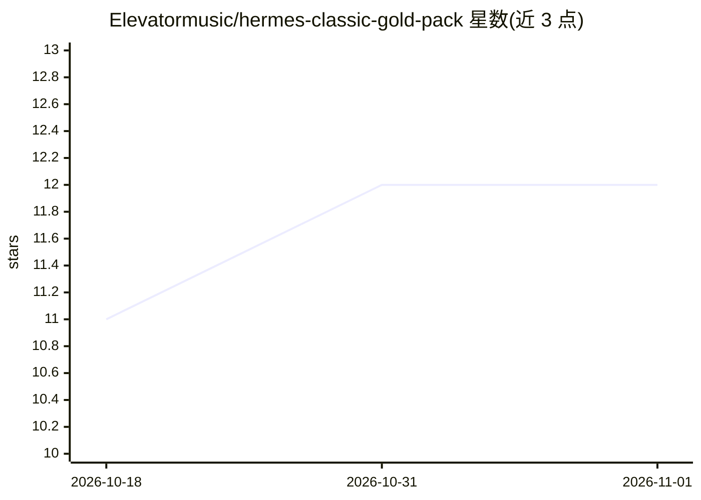

# Elevatormusic/hermes-classic-gold-pack

⭐ 12 · JavaScript · MIT · 推送 2026-10-07 · [GitHub](https://github.com/Elevatormusic/hermes-classic-gold-pack) · 个人维护

**Hermes-Agent 桌面 AI 助手的主题与遥测插件包**

面向 Nous Research 的 Hermes Agent 桌面客户端的外观与功能扩展包：通过 Hermes 公开插件 SDK 在 HERMES_HOME 下安装渲染端插件与 Python 遥测后端，提供 Classic Hermes 明暗主题、caduceus 背景、像素字标、可交互遥测条（速度/成本/缓存命中率/RAM/VRAM 等指标）以及模型、推理、provider、上下文控件，并附带两个 Noir Neko 桌面宠物。安装方式为 GitHub release ZIP 手动复制或 git clone 后运行 node install.mjs；支持远程后端分离安装与旧版源码补丁的还原式迁移；不修改 Hermes git checkout，更新后文件保留。

## 筛选速览

| 维度 | 判定 | 备注 |
|---|---|---|
| AI 角色 | `ai-ecosystem` | LLM/agent 周边工具 |
| 许可风险 | `permissive` | MIT |
| 部署形态 | `None` |  |
| 模型依赖 | — | README 未给出锁定关系 |
| 硬件要求 | — | 无带数字的原话,不猜 |
| 安装摩擦 | `low` | 无编译、无系统依赖或容器化 |
| 成熟度 | — | 结构信号不足 |

## 能力要点

- 渲染端插件 + Python 遥测后端的插件式安装，不改动 Hermes checkout
- 遥测条展示 token、速度、成本、缓存命中率、RAM/VRAM 等会话指标
- 支持模型/推理/provider/上下文控件与命令面板自定义页面
- 提供远程后端分离安装与旧源码补丁的还原式迁移脚本

## 适用场景

- 为 Hermes Agent 换用金色主题与自定义状态栏
- 在会话中查看 token、成本、缓存命中率与硬件占用
- 远程后端部署下分别安装渲染端与遥测后端

## 场景标签

 · 领域:桌面 AI Agent 定制工具

## 证据(README 行号)

> L10: The recommended install puts a renderer plug-in and a small telemetry backend
> L22: The renderer uses the public Hermes plug-in SDK. It contributes the `Classic
> L24: interactive telemetry tape, and a settings page. It also contributes model,

## 星数曲线

2026-10-18 11 → 2026-11-01 12（+1）

---
*卡片 v1 · prompt 1.4 · 生成 2026-11-01 · 置信度 mid · 依据 README sha `5bd4426b9816` · [字段定义](../../DATASET.md)*
