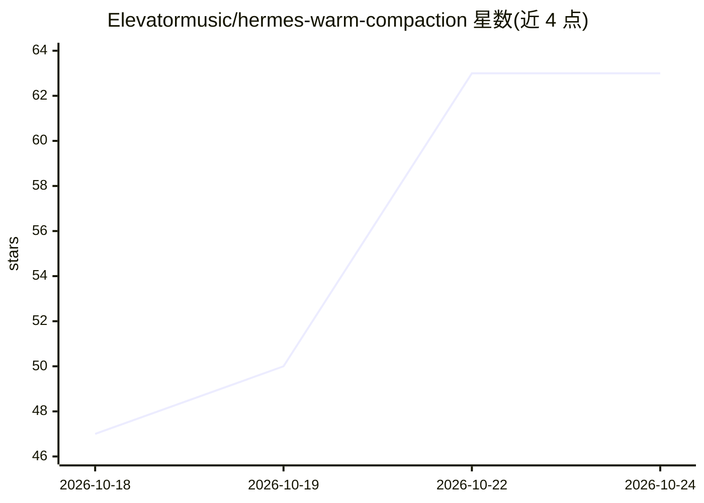

# Elevatormusic/hermes-warm-compaction

⭐ 65 · Python · Apache-2.0 · 推送 2026-10-22 · [GitHub](https://github.com/Elevatormusic/hermes-warm-compaction) · 个人维护

**Hermes Agent 的上下文压缩插件：利用前缀缓存加速压缩**

面向 Hermes Agent 的 context engine 插件。压缩时将主模型的最后一次请求连同新增行与交接指令重发，使服务器复用已缓存前缀、只读取新行，从而缩短压缩耗时；主模型生成含 Goal/User instructions 等六个标题的 Markdown 交接摘要，代码层附加记录命令与文件变更的 work ledger。仅使用文档化插件 API，无需补丁宿主；带模型回退与 ledger-only 回退路径。需 Hermes Agent 45871e10 或更高版本、Python 3.10+，无第三方依赖；加速效果依赖同一模型与服务器前缀缓存。

## 筛选速览

| 维度 | 判定 | 备注 |
|---|---|---|
| AI 角色 | `ai-ecosystem` | LLM/agent 周边工具 |
| 许可风险 | `permissive` | Apache-2.0 |
| 部署形态 | `None` |  |
| 模型依赖 | — | README 未给出锁定关系 |
| 硬件要求 | — | 无带数字的原话,不猜 |
| 安装摩擦 | `low` | 无编译、无系统依赖或容器化 |
| 成熟度 | — | 结构信号不足 |

## 能力要点

- 压缩时重发上次请求以复用前缀缓存，中位压缩时间 16.8s（对比内置 78.5s）
- 生成六标题 Markdown 交接摘要并保留近期原文尾部
- 代码生成的 work ledger 记录命令退出码与文件变更
- 支持阈值、尾部长度、超时等多项配置，含模型回退与 ledger-only 回退

## 适用场景

- Hermes Agent 长会话中加速上下文压缩
- 本地模型写不出有效摘要时仍能压缩并保留工作记录
- 对比不同压缩引擎的耗时与事实保留率

## 场景标签

 · 领域:LLM 基础设施/Agent 工具

## 证据(README 行号)

> L16: `warm_compaction` is a context engine plugin for Hermes Agent. At each compaction, the main model writes the handof
> L18: It works on unpatched Hermes Agent. It uses documented plugin APIs only: no host patch, no subclass of the built-in

## 星数曲线

2026-10-18 47 → 2026-10-24 63（+16）

---
*卡片 v1 · prompt 1.4 · 生成 2026-10-24 · 置信度 high · 依据 README sha `8df1c8d44ae7` · [字段定义](../../DATASET.md)*
