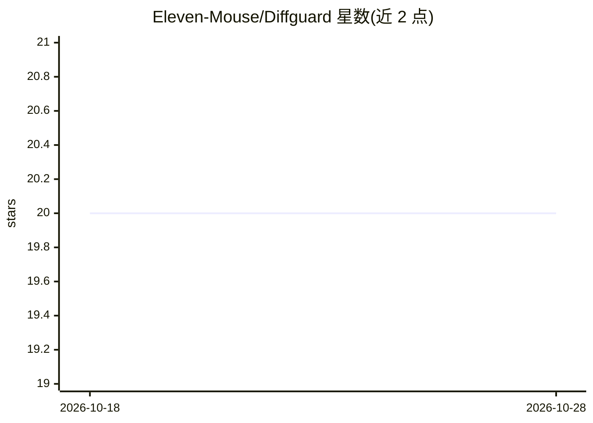

# Eleven-Mouse/Diffguard

⭐ 20 · Java · MIT · 推送 2026-09-28 · [GitHub](https://github.com/Eleven-Mouse/Diffguard) · 个人维护 · 中文 README

**LLM 驱动的多 Pipeline PR 代码审查工具，覆盖安全/逻辑/质量**

面向 GitHub PR 的代码审查工具：4 阶段流水线（摘要→三位并行领域审查员→聚合→误报过滤），由 Claude/OpenAI API 驱动。启用 Java Tool Server 后审查员变为 LangChain ReAct Agent，可调用 6 个工具读取源码、遍历调用图、做语义搜索。内置零成本静态规则（SQLi/密钥/危险调用）、28 条误报规则、Token 感知的大 PR 分块、熔断限流与 Prometheus 指标。提供 GitHub Action、本地 CLI 与 Docker Compose 三种部署方式。

## 筛选速览

| 维度 | 判定 | 备注 |
|---|---|---|
| AI 角色 | `ai-native` | 本体是模型或模型工具 |
| 许可风险 | `permissive` | MIT |
| 部署形态 | `self-host` | docker 或自建部署 |
| 模型依赖 | locked-api |  |
| 硬件要求 | — | 无带数字的原话,不猜 |
| 安装摩擦 | `low` | 无编译、无系统依赖或容器化 |
| 成熟度 | — | 结构信号不足 |

## 能力要点

- 4 阶段审查流水线与 Security/Logic/Quality 三位并行审查员
- LangChain ReAct Agent + 6 个代码上下文工具（AST/调用图/语义搜索）
- 正则+LLM 两级误报过滤与 28 条内置规则
- Token 感知 FFD 分块支持大型 PR

## 适用场景

- 在 GitHub PR 上自动进行安全与逻辑审查并发表内联评论
- 本地 CLI 在提交前预审查代码
- 团队自托管全栈（Gateway+Agent+RabbitMQ）接入代码审查

## 场景标签

`代码审查` · 领域:编码与开发

## 证据(README 行号)

> L18: **4 阶段流水线 · 3 位并行领域审查员 · 6 个工具调用 · 28 条误报规则 · 0 基础设施**
> L26: |Understands *your* codebase context|❌|⚠️ shallow|✅ **AST + Call Graph + RAG**|
> L33: > Unlike rule-only linters, DiffGuard uses LLM-powered deep analysis with optional **tool-calling ReAct agents** th

## 星数曲线

2026-10-18 20 → 2026-10-28 20（+0）

---
*卡片 v1 · prompt 1.4 · 生成 2026-10-28 · 置信度 high · 依据 README sha `3bf29d311d00` · [字段定义](../../DATASET.md)*
