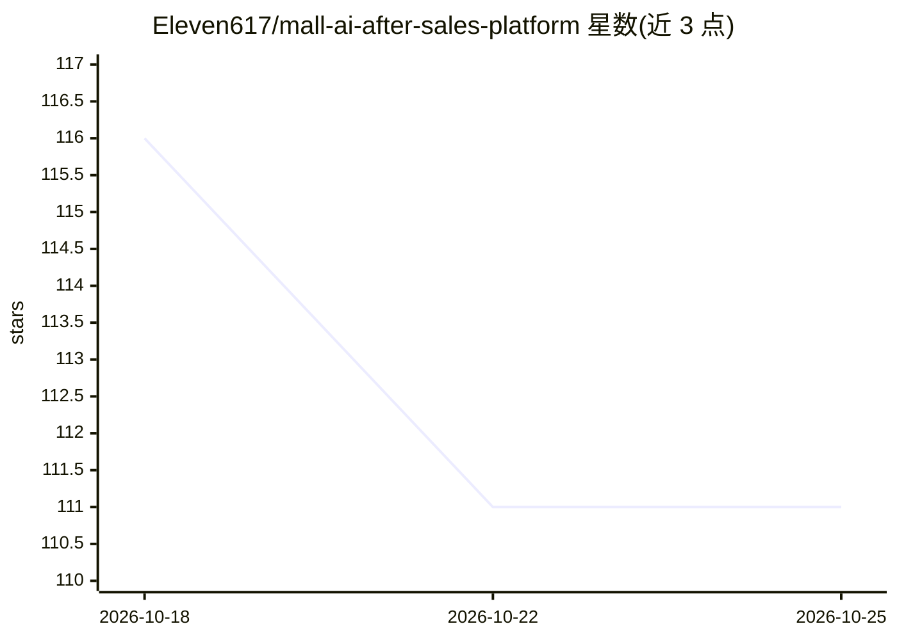

# Eleven617/mall-ai-after-sales-platform

⭐ 111 · Java · NOASSERTION · 推送 2026-10-12 · [GitHub](https://github.com/Eleven617/mall-ai-after-sales-platform) · 个人维护 · 中文 README

**电商 AI 售后系统：对话驱动的订单调查、政策 RAG 与受控业务执行**

面向电商售后场景的完整平台：客户在单一对话框描述需求，系统按问题分流至客服回答或多步 Agent 任务流程；订单与售后资格通过 Java Spring Boot 接口获取，政策问答走版本化知识检索（Dense/Hybrid/Rerank）并做证据核验。方案执行采用可确认的 ActionProposal 机制，Java 侧为权威写入方并做资格重校验、幂等与事务处理。支持随时转人工、人工售后闭环与运营改进分析。技术栈为 FastAPI + Spring Boot + MySQL/RabbitMQ/Redis/MongoDB，前端 Vue+TypeScript，DeepSeek 经统一模型网关接入。

## 筛选速览

| 维度 | 判定 | 备注 |
|---|---|---|
| AI 角色 | `ai-native` | 本体是模型或模型工具 |
| 许可风险 | `none` | NOASSERTION |
| 部署形态 | `self-host` | docker 或自建部署 |
| 模型依赖 | locked-api |  |
| 硬件要求 | — | 无带数字的原话,不猜 |
| 安装摩擦 | `low` | 无编译、无系统依赖或容器化 |
| 成熟度 | — | 结构信号不足 |

## 能力要点

- 对话驱动分流：统一入口按结构化模型决策选择客服链路或任务流程
- Java 权威写入：确认提交经资格重校验、幂等与事务处理，避免重复写入
- 版本化政策 RAG（Dense/Hybrid/Rerank）+ 来源、适用性与证据核验
- 随时转人工与人工售后闭环，交接后停止自动写入避免重复操作

## 适用场景

- 我开网店想让客户在对话框里直接办售后，不用填任务表单
- 需要人工确认+幂等写入的电商售后自动化流程
- 售后政策问答要求带证据核验和版本化知识检索

## 场景标签

`RAG` `聊天机器人` · 领域:对话与助手

## 证据(README 行号)

> L3: 基于真实商城业务的智能售后系统，连接自然语言对话、订单调查、政策检索和用户确认后的业务执行。客户只需在一个对话框描述需求，系统根据问题选择直接解答或多步 Agent 处理，在同一会话展示调查进度和处理方案。
> L30: 版本化政策知识支持 Dense / Hybrid / Rerank 检索，回答经过来源、适用性与证据核验。DeepSeek 通过统一模型网关接入，结构化输出、调用预算和 Ledger 对账用于控制模型调用；证据不足时请求补充信息或

## 星数曲线

2026-10-18 116 → 2026-10-25 111（-5）

---
*卡片 v1 · prompt 1.4 · 生成 2026-10-23 · 置信度 high · 依据 README sha `7a4e94b1395f` · [字段定义](../../DATASET.md)*
