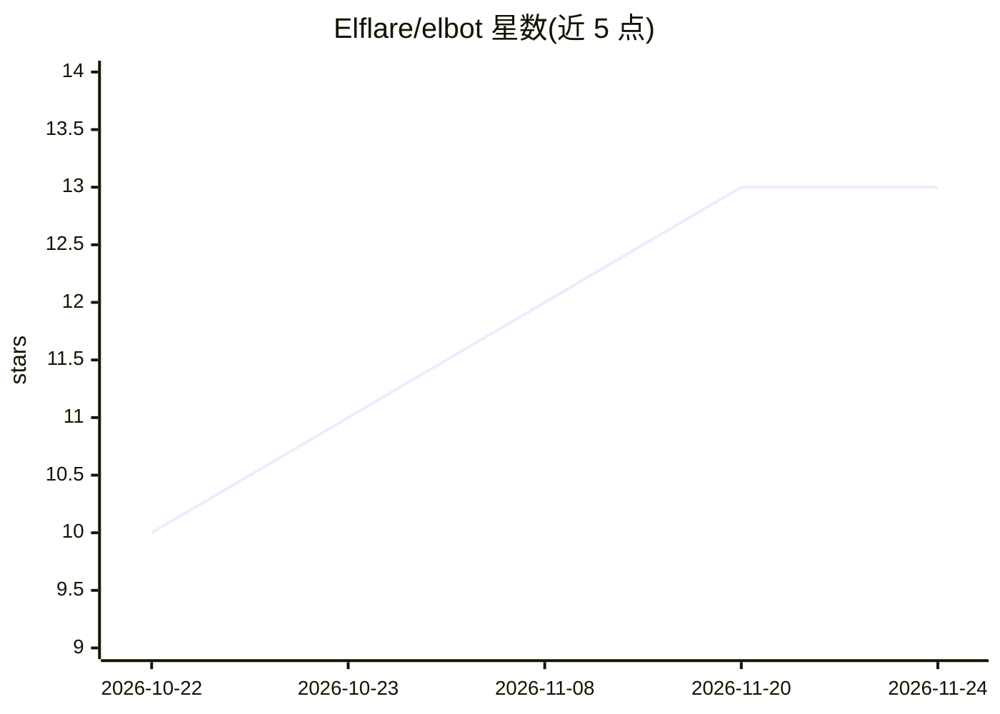

# Elflare/elbot

⭐ 13 · Go · Apache-2.0 · 推送 2026-11-22 · [GitHub](https://github.com/Elflare/elbot) · [官网](https://elfreese.github.io/elbot-landing/) · 个人维护 · 中文 README

**轻量 Go 语言 Agent/Chatbot 框架**

Go 编写的轻量 Agent/Chatbot 框架，目标是最小化运行成本、上下文成本与维护复杂度，同时保留扩展性。支持通用聊天、工具调用、Hook 扩展、长期任务调度、持久 Session 与上下文压缩。通过按需工具发现（仅暴露 discover_tool）节省 token；提供 chat/work 双模式可配独立模型；分层驻留记忆与基于 SQLite FTS 的长期记忆；Elnis 事件感知系统支持外部事件触发。README 注明项目仍在快速开发中，适合作为个人 Agent/bot 框架进行探索。

## 筛选速览

| 维度 | 判定 | 备注 |
|---|---|---|
| AI 角色 | `ai-ecosystem` | LLM/agent 周边工具 |
| 许可风险 | `permissive` | Apache-2.0 |
| 部署形态 | `None` |  |
| 模型依赖 | — | README 未给出锁定关系 |
| 硬件要求 | — | 无带数字的原话,不猜 |
| 安装摩擦 | `low` | 无编译、无系统依赖或容器化 |
| 成熟度 | `idea` | |

## 能力要点

- 按需工具发现机制：每轮不注入全部工具 schema，降低 token 消耗
- Chat/Work 双模式可配置不同模型，分别面向低成本聊天与复杂任务
- Hook 系统覆盖输入/请求/响应/平台发送等事件点，插件可用任意语言编写
- Elnis 事件感知：通过外部监听器接收系统告警、RSS、Webhook 等事件驱动 Agent

## 适用场景

- 搭建个人助手或平台 bot（CLI、QQ、Telegram 等平台）
- 编写需要工具调用的自动化编排助手
- 定时任务中结合 LLM 进行分析、摘要或工具调用
- 让 bot 响应系统告警、RSS 更新等外部事件

## 场景标签

`Agent 框架` · 领域:Agent 开发

## 证据(README 行号)

> L11: ElBot is a lightweight Agent/Chatbot framework written in Go, aiming to minimize operating costs, context costs, an
> L12: It supports general chat, tool calling, Hook extensions, long-term task scheduling, persistent Sessions, and contex

## 星数曲线

2026-10-22 10 → 2026-11-24 13（+3）

---
*卡片 v1 · prompt 1.4 · 生成 2026-11-18 · 置信度 high · 依据 README sha `b5def7f8b609` · [字段定义](../../DATASET.md)*
